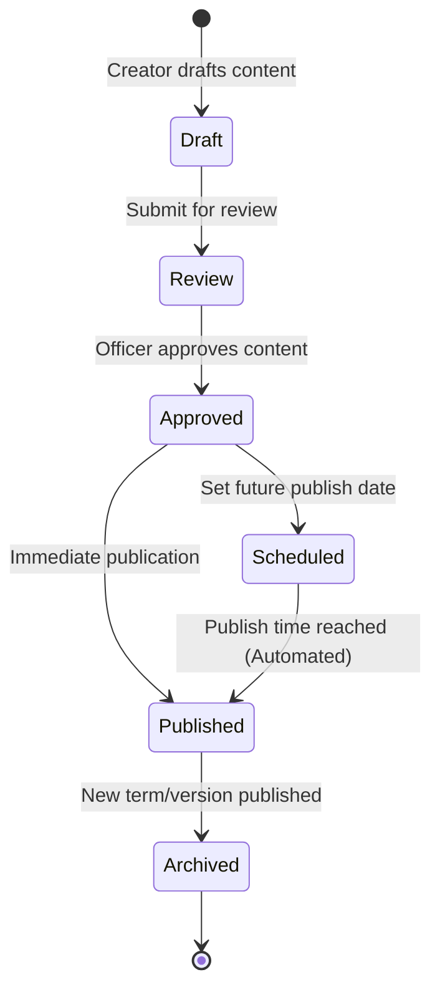

# RYCOOPWEB — CONTENT PUBLICATION ARCHITECTURE

**Repository:** `pharmacisttom/rycoopweb`
**Branch:** `feature/full-data-consistency-recovery`
**Environment:** TEST ONLY

---

## 1. Architectural Principles

1. **Single Source of Truth:**
   Public Website and Admin Backend must operate on the exact same database tables. Never create competing or duplicated storage engines for public content.
2. **Strict Draft Isolation:**
   Unapproved or draft changes (e.g., Committee Term 39, draft welfare programs, draft interest rates) must never be accessible on public endpoints.
3. **Optimistic Concurrency Control:**
   All mutating operations calculate and compare SHA-256 version hashes to prevent lost updates in multi-editor workflows.
4. **Comprehensive Audit Trail:**
   Every creation, modification, status change, schedule, and publication event must generate an immutable audit record in `audit_logs`.
5. **Fail-Closed Security:**
   If a publication gate, permission check, or audit logging operation fails, the transaction rolls back immediately and no state is mutated.

---

## 2. Six-Stage Publication Lifecycle



### Stage Definitions

1. **Draft (`draft`):** Content created by an authorized editor. Visible strictly within Admin preview. Never exposed to public endpoints.
2. **Review (`review`):** Content flagged for review. Awaiting review by a designated reviewer or officer with approval privileges.
3. **Approved (`approved`):** Verified content awaiting deployment or scheduling.
4. **Scheduled (`scheduled`):** Approved content with a defined future publication timestamp (`publish_at`). When `publish_at <= NOW()`, the system atomically transitions the content to `published`.
5. **Published (`published`):** Currently active public presentation. The Public API filters for `status = 'published'` (and `is_current = 1` for singleton terms).
6. **Archived (`archived`):** Former published content preserved for historical reference and audit compliance.

---

## 3. Publication Subsystem Mapping

| Subsystem | Publication Engine | Database Tables | Optimistic Concurrency | Public Filtering Clause |
|---|---|---|---|---|
| **Board & Committee Terms** | `BoardTermService` | `board_terms`, `board_term_members`, `board_term_groups` | SHA-256 record version hash | `status = 'published' AND is_current = 1` |
| **Public CMS (Profile, Rates, Products)** | `PublicContentService` | `site_settings`, `public_content_revisions` | SHA-256 catalog version hash | `state = 'published' AND effective_on <= CURDATE() AND (expires_on IS NULL OR expires_on >= CURDATE())` |
| **Welfare Programs** | `WelfareController` | `welfare` | Updated timestamp versioning | `status = 'active' AND deleted_at IS NULL` |
| **News & Announcements** | `NewsWorkflowService` | `news`, `important_announcements` | Workflow state machine | `workflow_status = 'published' AND (publish_at IS NULL OR publish_at <= NOW())` |
| **Smart Popups V2** | `PopupController` | `popups`, `popup_pages` | Priority ordering & datetime window | `status = 'active' AND (start_at IS NULL OR start_at <= NOW()) AND (end_at IS NULL OR end_at >= NOW())` (Max 3) |
| **Downloadable Documents** | `DocumentController` | `documents`, `document_categories` | Category sorting & status flag | `status = 'published' AND deleted_at IS NULL` |
| **Complaints & Feedback** | `ComplaintController` | `complaints`, `complaint_logs` | Server ticket number & lifecycle logs | Authorized officer access only; public tracking by unique ticket |
| **Online E-Services** | `EServiceController` | `eservice_links` | Sort order & active status | `status = 'active'` |

---

## 4. Role-Based Access Control (RBAC) & Separation of Duties (SoD)

```text
Role                 Permissions
--------------------------------------------------------------------------------------
super_admin          Full system access, role management, user administration
manager / executive  Approve and publish CMS revisions, board terms, policy updates
staff / pr_officer   Draft and edit news, documents, FAQs, hero slides (No direct publish)
complaint_officer    View complaints, assign officers, update investigation logs, reply
welfare_officer      Manage welfare programs, review member assistance applications
auditor              Strictly read-only access (.view and .export only across all modules)
member               Zero administrative permissions; access restricted to authenticated portal
```
