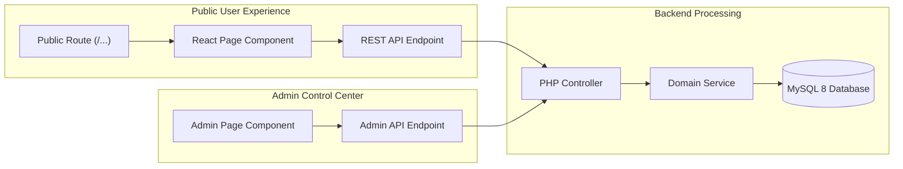

# RYCOOPWEB — PUBLIC / ADMIN ROUTE & API ARCHITECTURE MATRIX

**Repository:** `pharmacisttom/rycoopweb`
**Branch:** `feature/full-data-consistency-recovery`
**Environment:** TEST ONLY
**Design System:** Modern Design System 3.1

---

## 1. End-to-End Architectural Matrix

This matrix maps every public customer-facing interface directly to its corresponding backend API, PHP controller, MySQL database table, rendered UI, and administrative management interface.

---

## 2. Comprehensive Route Matrix

### 1. Board & Committee Governance
- **Public Route:** `/board`, `/board_committee`
- **Frontend Component:** [`BoardPage.jsx`](file:///d:/rycoopweb/src/pages/BoardPage.jsx)
- **Public API:** `GET /api/public/content`, `GET /api/public/board-members`, `GET /api/public/board-terms/history`
- **PHP Controller:** [`SpaApiController.php`](file:///d:/rycoopweb/app/Controllers/Api/SpaApiController.php), [`PublicContentService.php`](file:///d:/rycoopweb/app/Services/PublicContentService.php), [`BoardTermService.php`](file:///d:/rycoopweb/app/Services/BoardTermService.php)
- **MySQL Tables:** `board_terms`, `board_term_members`, `board_term_groups`, `board_term_group_members`
- **API Response:** `{ success: true, data: { boardMembers: [...], boardGroups: [...], advisors: [...], auditors: [...], currentTerm: "ชุดที่ 38" } }`
- **Rendered UI:** Grid of directors with photos, chairperson badge, advisors, auditors, and committee subgroups.
- **Admin Route:** `/admin/board-staff`
- **Admin Component:** [`AdminBoardPersonnelPage.jsx`](file:///d:/rycoopweb/src/pages/AdminBoardPersonnelPage.jsx)
- **Admin API:** `GET/POST/PUT /api/admin/board-terms/*`
- **Governance State:** Multi-term support, draft isolation, copy-term cloning, and scheduled publication.

---

### 2. Complaints & Member Voice
- **Public Route:** `/contact`, `/complaints`
- **Frontend Component:** [`ContactPage.jsx`](file:///d:/rycoopweb/src/pages/ContactPage.jsx)
- **Public API:** `POST /api/public/complaints` (Submit), `GET /api/public/complaints/track` (Track status)
- **PHP Controller:** [`ComplaintController.php`](file:///d:/rycoopweb/app/Controllers/Public/ComplaintController.php) / [`SpaApiController.php`](file:///d:/rycoopweb/app/Controllers/Api/SpaApiController.php)
- **MySQL Tables:** `complaints`, `complaint_logs`
- **API Response:**
  - Submit: `{ success: true, ticket_no: "TKT-202611-0001", message: "ส่งเรื่องร้องเรียนสำเร็จ" }`
  - Track: `{ success: true, data: { ticket_no: "...", status: "received", status_label: "รอดำเนินการ", created_at: "...", logs: [...] } }`
- **Rendered UI:** Contact information cards, submission form, and secure real-time status tracker timeline.
- **Admin Route:** `/admin/control-center` (Inbox) / `/admin/complaints`
- **Admin Component:** [`AdminControlCenterPage.jsx`](file:///d:/rycoopweb/src/pages/AdminControlCenterPage.jsx)
- **Admin API:** `GET /api/admin/complaints`, `POST /api/admin/complaints/{id}/status`

---

### 3. Downloadable Documents & Forms
- **Public Route:** `/documents`
- **Frontend Component:** [`DocumentsPage.jsx`](file:///d:/rycoopweb/src/pages/DocumentsPage.jsx)
- **Public API:** `GET /api/public/documents`, `GET /api/public/documents/{id}/download`
- **PHP Controller:** [`SpaApiController.php`](file:///d:/rycoopweb/app/Controllers/Api/SpaApiController.php), [`DocumentController.php`](file:///d:/rycoopweb/app/Controllers/Admin/DocumentController.php)
- **MySQL Tables:** `documents`, `document_categories`
- **API Response:** `{ success: true, data: [ { id: 1, title: "...", category: "...", file_path: "...", file_size: 450120, download_count: 12, created_at: "..." } ] }`
- **Rendered UI:** Categorized document table with search filter, real file size format, and direct download buttons.
- **Admin Route:** `/admin/documents`, `/admin/document-categories`
- **Admin Component:** [`AdminStoredContentPage.jsx`](file:///d:/rycoopweb/src/pages/AdminStoredContentPage.jsx), [`AdminDocumentCategoriesPage.jsx`](file:///d:/rycoopweb/src/pages/AdminDocumentCategoriesPage.jsx)
- **Admin API:** `GET/POST/PUT/DELETE /api/admin/documents`, `/api/admin/document-categories`

---

### 4. Welfare & Member Assistance Programs
- **Public Route:** `/welfare`, `/associations`, `/mutual-aid`
- **Frontend Component:** [`WelfarePage.jsx`](file:///d:/rycoopweb/src/pages/WelfarePage.jsx)
- **Public API:** `GET /api/public/welfare`
- **PHP Controller:** [`SpaApiController.php`](file:///d:/rycoopweb/app/Controllers/Api/SpaApiController.php), [`WelfareController.php`](file:///d:/rycoopweb/app/Controllers/Admin/WelfareController.php)
- **MySQL Tables:** `welfare`
- **API Response:** `{ success: true, data: [ { id: 1, category: "...", title: "...", benefit_amount: "...", eligibility: "...", required_documents: "...", status: "active" } ] }`
- **Rendered UI:** Welfare program cards detailing grant limits, qualification requirements, required documents, and application steps.
- **Admin Route:** `/admin/welfare`
- **Admin Component:** [`AdminWelfarePage.jsx`](file:///d:/rycoopweb/src/pages/AdminWelfarePage.jsx)
- **Admin API:** `GET/POST/PUT/DELETE /api/admin/welfare/*`

---

### 5. Loans, Deposits & Rates
- **Public Route:** `/loans`, `/deposits`, `/rates`, `/calculator`
- **Frontend Component:** [`LoansPage.jsx`](file:///d:/rycoopweb/src/pages/LoansPage.jsx), [`DepositsPage.jsx`](file:///d:/rycoopweb/src/pages/DepositsPage.jsx), [`CalculatorPage.jsx`](file:///d:/rycoopweb/src/pages/CalculatorPage.jsx)
- **Public API:** `GET /api/public/content`, `GET /api/public/interest-rates`, `GET /api/public/loan-products`
- **PHP Controller:** [`SpaApiController.php`](file:///d:/rycoopweb/app/Controllers/Api/SpaApiController.php), [`PublicContentService.php`](file:///d:/rycoopweb/app/Services/PublicContentService.php)
- **MySQL Tables:** `site_settings`, `public_content_revisions`, `loan_products`, `deposit_products`, `interest_rates`
- **API Response:** `{ success: true, data: { deposit: [...], loan: [...] }, publication: { ... } }`
- **Rendered UI:** Rate comparison tables with official effective date notices and interactive financial calculator.
- **Admin Route:** `/admin/public-content`, `/admin/products`
- **Admin Component:** [`PublicContentAdminPage.jsx`](file:///d:/rycoopweb/src/pages/PublicContentAdminPage.jsx), [`AdminProductsPage.jsx`](file:///d:/rycoopweb/src/pages/AdminProductsPage.jsx)
- **Admin API:** `GET/POST/PUT /api/admin/public-content/*`, `/api/admin/products/*`

---

### 6. News, Announcements & Hero Slides
- **Public Route:** `/`, `/news`, `/announcements`, `/events`
- **Frontend Component:** [`HomePage.jsx`](file:///d:/rycoopweb/src/pages/HomePage.jsx), [`NewsPage.jsx`](file:///d:/rycoopweb/src/pages/NewsPage.jsx)
- **Public API:** `GET /api/public/news`, `GET /api/public/announcements`, `GET /api/public/hero-slides`, `GET /api/public/popups`
- **PHP Controller:** [`SpaApiController.php`](file:///d:/rycoopweb/app/Controllers/Api/SpaApiController.php)
- **MySQL Tables:** `news`, `news_categories`, `important_announcements`, `hero_slides`, `popups`
- **API Response:** List of published articles with cover image, title, summary, publication date, and pagination metadata.
- **Rendered UI:** Homepage hero banner carousel, active announcement pill, news grid, popup dialogs (max 3).
- **Admin Route:** `/admin/content`, `/admin/hero-slides`, `/admin/popups`
- **Admin Component:** [`ContentAdminPage.jsx`](file:///d:/rycoopweb/src/pages/ContentAdminPage.jsx), [`AdminHeroSlidesPage.jsx`](file:///d:/rycoopweb/src/pages/AdminHeroSlidesPage.jsx), [`AdminPopupsPage.jsx`](file:///d:/rycoopweb/src/pages/AdminPopupsPage.jsx)
- **Admin API:** `GET/POST/PUT/DELETE /api/admin/news`, `/api/admin/hero-slides`, `/api/admin/popups`

---

### 7. Online E-Services
- **Public Route:** `/eservice`
- **Frontend Component:** [`EServicePage.jsx`](file:///d:/rycoopweb/src/pages/EServicePage.jsx)
- **Public API:** `GET /api/public/eservices`
- **PHP Controller:** [`SpaApiController.php`](file:///d:/rycoopweb/app/Controllers/Api/SpaApiController.php), [`EServiceController.php`](file:///d:/rycoopweb/app/Controllers/Admin/EServiceController.php)
- **MySQL Tables:** `eservice_links`
- **API Response:** `{ success: true, data: [ { id: 1, title: "...", url: "...", icon: "...", is_external: true } ] }`
- **Rendered UI:** Service card links to external government/cooperative portals and downloadable tools.
- **Admin Route:** `/admin/eservices`
- **Admin Component:** [`AdminEServicesPage.jsx`](file:///d:/rycoopweb/src/pages/AdminEServicesPage.jsx)
- **Admin API:** `GET/POST/PUT/DELETE /api/admin/eservices/*`
