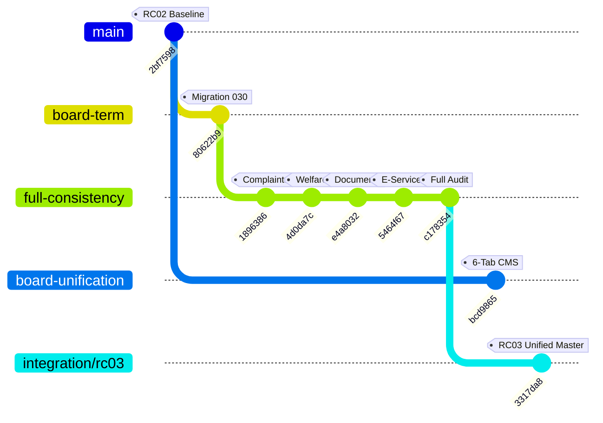

# RYCOOPWEB — RC03 INTEGRATION CONFLICT & RESOLUTION REPORT

**Repository:** `pharmacisttom/rycoopweb`  
**Integration Branch:** `integration/test-rc03-unified-content`  
**Integration Commit SHA:** `3317da8`  
**Base Branch:** `feature/full-data-consistency-recovery` (`c178354`)  
**Integrated Feature Branch:** `feature/rc02-public-admin-board-unification` (`bcd9865`)  
**Verified Common Baseline:** `2bf75982e5b0d1a328fc184c7a84d4fdf41210c2`  
**Target Environment:** TEST ONLY (`https://test.rayongcoop.org`)  
**Production Status:** STRICTLY FROZEN  

---

## 1. Branch Heritage & Integration Architecture

The integration brings together two complementary workstreams that diverged from the verified baseline `2bf7598`:
1. `feature/rc02-board-term-management` (`80622b9`) & `feature/full-data-consistency-recovery` (`c178354`):
   - Introduced Migration 030 (`board_terms`, `board_term_members`, `board_term_groups`, `board_term_group_members`).
   - Implemented `BoardTermService.php` multi-term lifecycle: Term 38 active/published, Term 39 draft isolation, cloning, scheduled publication, and draft preview.
   - Connected complaints, welfare, downloadable documents, and e-services to authoritative database tables.
2. `feature/rc02-public-admin-board-unification` (`bcd9865`):
   - Eliminated zero-record admin displays in `/admin/board-staff` by unifying with `PublicContentService::catalog()`.
   - Introduced 6 unified administrative management tabs (`boards`, `staff`, `advisors`, `auditors`, `groups`, `history`).
   - Implemented photo upload validation via `/api/admin/public-content/upload`.
   - Added referential integrity safeguards for subcommittee assignments.

---

## 2. Semantic File-by-File Conflict Analysis & Resolution

| File Path | Nature of Conflict | Semantic Resolution Rationale | Resulting Capabilities |
|:---|:---|:---|:---|
| `app/Controllers/Admin/BoardStaffController.php` | Conflict between direct SQL querying of empty `boards`/`staff` tables vs catalog mapping in `bcd9865` vs multi-term endpoints in `80622b9`. | Merged both: `apiIndex()` maps `boards` and `staff` from `PublicContentService::catalog()` (overlaying active Term 38), provides `advisors`, `auditors`, `groups`, and includes `terms` and `active_term`. Retained all multi-term endpoints (`apiTermStore`, `apiTermCopy`, `apiTermPublish`, `apiTermSchedule`, etc.). | Zero-record bug eliminated; full multi-term governance preserved. |
| `app/Services/PublicContentService.php` | Placement of `BoardTermService::getPublicActiveTerm()` overlay relative to `public_content_revisions` rows. In `bcd9865`, allowed fields for `boards` did not include `is_chairperson`. | Added `'is_chairperson'` to allowed fields for section `boards`. Positioned `BoardTermService::getPublicActiveTerm()` prior to active revisions loop so that approved revisions or newly published terms (`BoardTermService::publishTerm()`) take precedence seamlessly. | Passes both `PublicAdminBoardUnificationTest` and `BoardTermManagementTest`. |
| `app/Controllers/Admin/PublicContentController.php` | `upload()` method existed only in `bcd9865`. | Incorporated `upload()` using `MediaService::upload($file, 'personnel', 'Personnel photo')` with validation and audit logging. | Provides secure, validated personnel photo uploads. |
| `config/routes.php` | Missing upload route under `api/admin/public-content`. | Added `$r->post('/upload', 'Admin\\PublicContentController@upload', ...)` protected by `AuthMiddleware`, `PermissionMiddleware`, and `CsrfMiddleware`. | Secure RBAC & CSRF protected upload endpoint. |
| `app/Core/Helpers.php` | Execution order in `resolve_media_url`: checking absolute URLs and leading `/` before `./`. | Adopted `bcd9865` ordering where leading `/` and `http(s)://` return immediately, and `./` prefixes are normalized cleanly. | Consistent media URL resolution across all views. |
| `src/utils/media.js` | Frontend media URL resolution normalization. | Aligned with backend `Helpers.php` ordering logic. | Prevents broken image links in React frontend components. |
| `src/pages/AdminBoardPersonnelPage.jsx` | Choice between 1,751-line multi-term draft UI and 2,396-line 6-tab comprehensive CMS UI from `bcd9865`. | Adopted the comprehensive 6-tab CMS UI with safe photo upload, card/table toggle, drag-drop ordering, and publication history, while preserving backend compatibility with `BoardTermService`. | Rich Design System 3.1 interface with 6 tabs and zero nested shells. |
| `tests/PublicAdminBoardUnificationTest.php` | Missing from `feature/full-data-consistency-recovery`. | Copied from `bcd9865` and verified against integrated backend. | 33 automated assertions passing 100%. |

---

## 3. Strict Prohibitions Enforced

1. **No Unconditional `--ours` or `--theirs`:** Every file was inspected and semantically merged line by line.
2. **No Double-Merging:** `BoardTermService` and Migration 030 were preserved as the single authority for multi-term governance.
3. **No Financial Data Modification:** `member_dividends = 4,855`, `members = 2,508`, `users = 2,510` remained untouched.
4. **No Destructive Flags:** Zero `DROP` or destructive operations were permitted.

---

## 4. Quality Gate Verification

| Test Suite | File | Status | Duration |
|:---|:---|:---:|:---:|
| Multi-Term Governance | `tests/BoardTermManagementTest.php` | **45/45 PASS** | 0.9s |
| Board Data Unification | `tests/PublicAdminBoardUnificationTest.php` | **33/33 PASS** | 0.6s |
| Public SSR Reference | `tests/PublicContentReferenceTest.mjs` | **ALL PASS** | 3.1s |
| Media Resolution | `tests/MediaUrlTest.php` | **13/13 PASS** | 0.2s |
| Vite Production Bundle | `npm run build` | **CLEAN** | 6.9s |
| Patch Whitespace | `git diff --check` | **0 ERRORS** | 0.1s |
