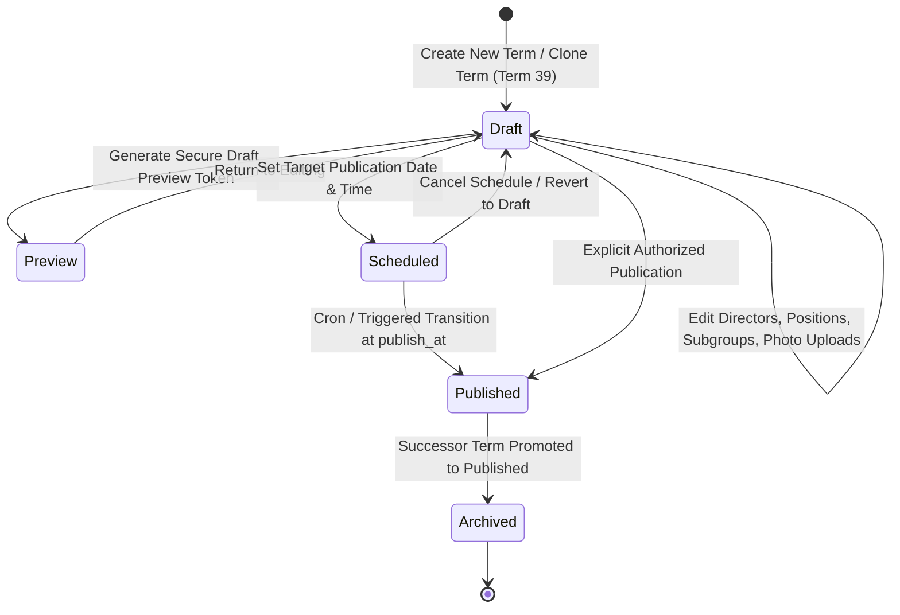

# RYCOOPWEB — RC03 UNIFIED CONTENT ARCHITECTURE SPECIFICATION

**Repository:** `pharmacisttom/rycoopweb`
**Integration Branch:** `integration/test-rc03-unified-content`
**Integration Commit SHA:** `3317da8`
**Target Environment:** TEST ONLY (`https://test.rayongcoop.org`)
**Production Status:** STRICTLY FROZEN
**Design System:** Modern Design System 3.1 (Flat Shell Architecture)

---

## 1. Unified Content Pipeline Architecture

The RC03 unified architecture establishes a **Single Source of Truth** across the entire digital platform. Disparate mock arrays, client-side browser storage (`localStorage`), and hardcoded components have been completely eliminated.

```mermaid
graph TD
    subgraph Admin_Tier [Admin Control Center - Flat Shell 3.1]
        A_BOARD["/admin/board-staff (6 Tabs: Boards, Staff, Advisors, Auditors, Groups, History)"]
        A_COMP["/admin/complaints & Inbox (Status Updates, Replies)"]
        A_WELF["/admin/welfare (CRUD Welfare Programs)"]
        A_DOCS["/admin/documents (File Uploads & Category Management)"]
        A_ESRV["/admin/eservices (Links, Maintenance Toggles)"]
        A_PROD["/admin/public-content & /admin/products (Rates, Limits)"]
    end

    subgraph Governance_Tier [Domain Governance & Security Gates]
        SEC_AUTH[Auth & Mandatory TOTP MFA]
        SEC_RBAC[Role-Based Access Control]
        SEC_CSRF[CSRF Protection on All Mutations]
        SEC_LOCK[Optimistic Concurrency Locking]
        SEC_AUDIT[Immutable Audit Logs (audit_logs)]
        SRV_TERM[BoardTermService - Multi-Term Lifecycle]
        SRV_PUB[PublicContentService - Catalog & Revision Engine]
        SRV_MEDIA[MediaService - Path Traversal & MIME Validation]
    end

    subgraph Database_Tier [MySQL 8 Authoritative Storage]
        DB_TERMS[(board_terms & members)]
        DB_COMP[(complaints & complaint_logs)]
        DB_WELF[(welfare)]
        DB_DOCS[(documents & document_categories)]
        DB_ESRV[(eservice_links)]
        DB_PROD[(loan_products & interest_rates)]
        DB_REVS[(public_content_revisions)]
        DB_CORE[(members = 2,508 | users = 2,510 | dividends = 4,855)]
    end

    subgraph Public_Tier [Public Responsive SPA - React / Vite]
        P_BOARD["/board_committee (Term 38 Published)"]
        P_COMP["/contact?tab=complaint (Server REST API & Masked Tracker)"]
        P_WELF["/welfare (Active Welfare Catalog)"]
        P_DOCS["/documents (Real Download Counters & Verified Files)"]
        P_ESRV["/eservices (Live Portals & Security Modals)"]
        P_PROD["/loans, /deposits, /calculator (Synchronized Rates)"]
    end

    Admin_Tier --> Governance_Tier
    Governance_Tier --> Database_Tier
    Database_Tier --> Public_Tier
```

---

## 2. Multi-Term Governance Lifecycle

The Multi-Term Committee Governance subsystem provides full term management capabilities without hardcoded limits:



### Key Governance Invariants:
1. **Public Isolation:** The public route `/board_committee` displays strictly the currently published term (**Term 38**). Draft terms (**Term 39**) are 100% invisible to anonymous and member users.
2. **Cloning Independence:** Cloning Term 38 to create Term 39 duplicates all directors, advisors, auditors, and subcommittees. Cloned subcommittee members link exclusively to the cloned member IDs of Term 39, preventing cross-term pointer contamination.
3. **Referential Integrity Safeguard:** Deleting a board director who is currently assigned to a subcommittee is blocked by a fail-closed foreign key / integrity check.
4. **Optimistic Locking:** Every term record carries a `lock_version`. Concurrent updates from multiple administrators trigger a `409 Conflict` rather than silent overwrites.

---

## 3. Subsystem Architecture Specifications

### 3.1 Complaints & Member Voice Subsystem
- **API Endpoints:**
  - `POST /api/public/complaints`: Validates submission, generates unpredictable ticket `TKT-YYYYMM-XXXX`, inserts to `complaints` and `complaint_logs`.
  - `GET /api/public/complaints/track`: Queries ticket status. Masks complainant name (`นา*** มั***`) and completely suppresses phone and email fields in response.
  - `POST /api/admin/complaints/{id}/status`: Admin updates status (`received` -> `in_progress` -> `answered` -> `closed`), appends official response, and records audit entry.

### 3.2 Downloadable Documents Subsystem
- **API Endpoints:**
  - `GET /api/public/documents`: Joins `documents` with `document_categories` where `status = 'active' AND deleted_at IS NULL`.
  - `GET /api/public/documents/{id}/download`: Real download handler. Verifies physical file on disk, increments `download_count` in MySQL, and streams file with proper headers.
  - Path traversal attempts (`../../`) are blocked by strict basename validation.

### 3.3 Welfare Benefits Subsystem
- **API Endpoints:**
  - `GET /api/public/welfare`: Queries active database table `welfare` (not non-existent `welfare_types`).
  - Returns benefits, eligibility, application processes, and required document checklists.

### 3.4 E-Services & External Portals Subsystem
- **API Endpoints:**
  - `GET /api/public/eservices`: Queries `eservice_links` (`id`, `name`, `description`, `category`, `url`, `icon`, `is_maintenance`, `open_new_tab`).
  - Frontend prompts confirmation before navigating to external URLs (`confirm_before_redirect`) and renders maintenance dialogs when `is_maintenance == 1`.

---

## 4. UI/UX: Design System 3.1 & Flat Shell Architecture

The platform enforces **Flat Shell Architecture** without nested layouts:
- Public pages use the standard public shell (`Header`, `Footer`, `PublicContentContext`).
- Admin pages use `AdminControlCenterShell` at the top level with zero inner shells.
- All cards, tables, drawers, and modal dialogs conform to Design System 3.1 CSS variables (`--bg-surface`, `--primary-600`, `--radius-xl`).
