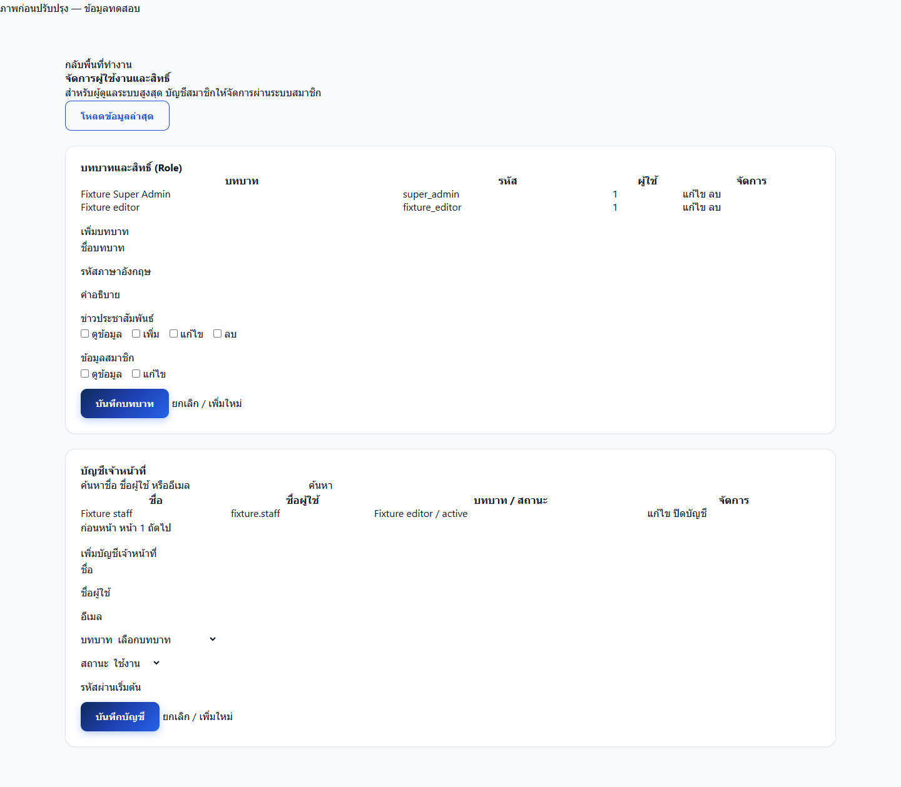
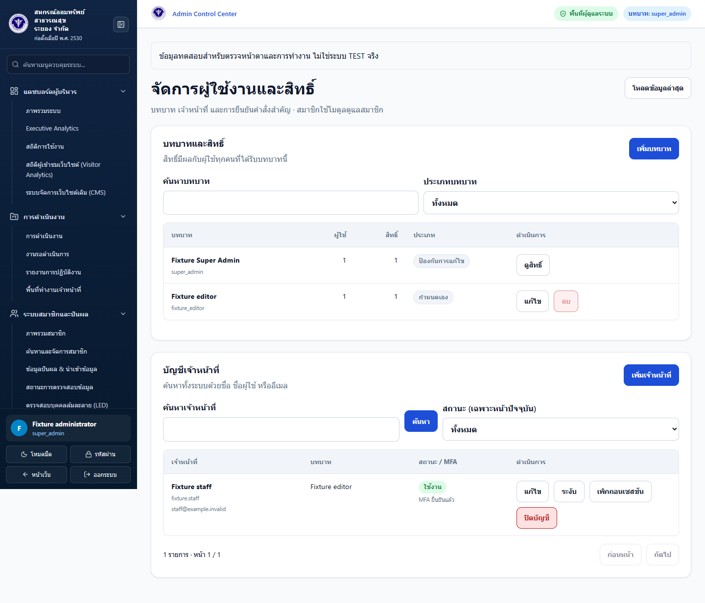
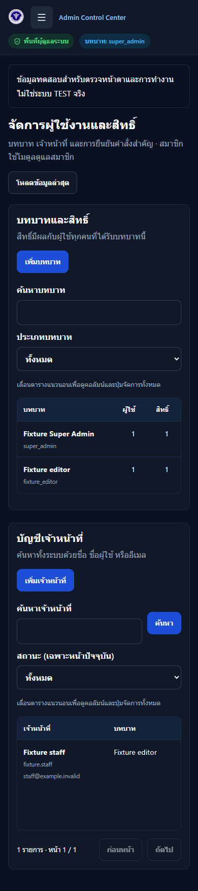
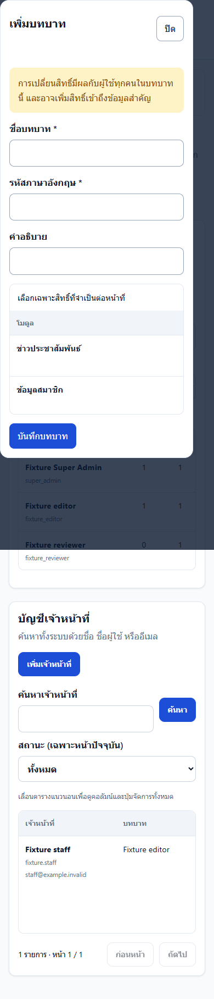
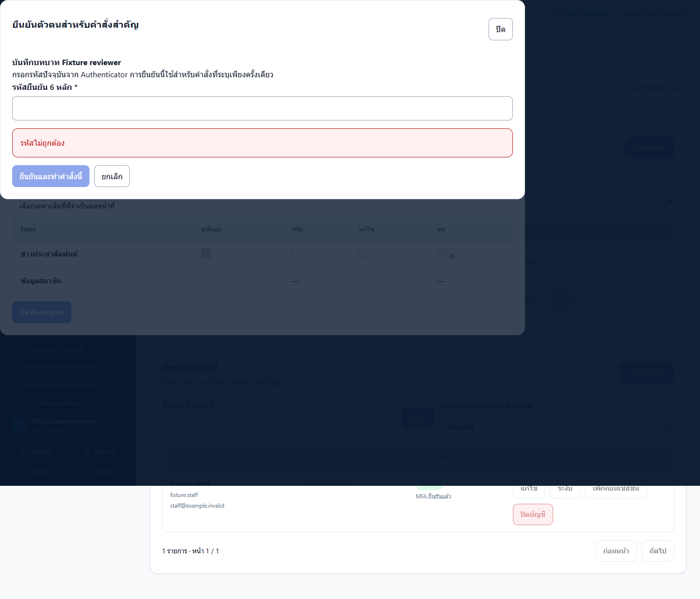
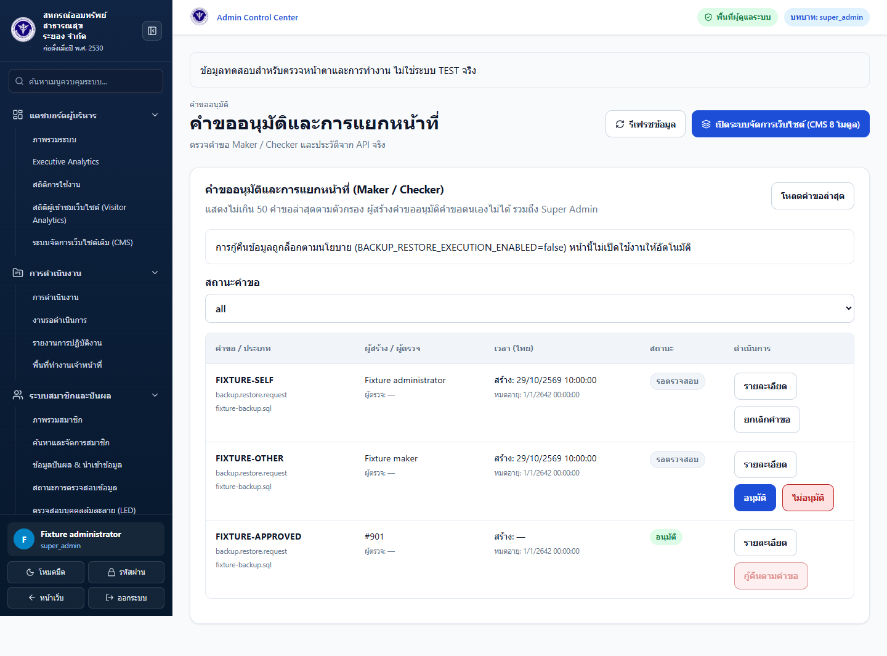

# Admin UI/UX release, QA and TEST UAT

User instruction on 2026-10-29: finish local validation first; authenticated TEST UAT
will follow later. No live TEST/Production deployment or account mutation is part of this change.

## Review order and scope

1. PR #7 `codex/activity-slideshow`: activity albums and slideshow, independent feature.
2. PR #8 `codex/fix-global-logo-branding`: canonical verified official seal and all brand integration.
3. `codex/admin-uiux-modernization`: shared admin UI, with slideshow and branding commits already integrated;
   review branding first, then review the UI changes against that baseline.

All PRs target `Test`. No automatic merge, Production push or deployment.
No new migration; do not rerun migration 025, and keep 019/020 on hold.
The UI-specific commit changes no PHP controller, security service, route, migration or MySQL schema. The candidate branch includes the previously reviewed slideshow backend changes unchanged from PR #7.

## What changed

- Existing Control Center shell is reused as `AdminAppShell`; a shell context prevents
  duplicate sidebars when a module already supplies its own shell/header.
- All verified staff routes share navigation, topbar, theme and readable content width.
  Public/member navigation stays separate, and login/MFA remain isolated before staff entry.
- Sidebar has 14 groups pointing to actual existing modules plus an approval page
  backed by the existing approval API. `/admin/control-center` aliases the dashboard.
- Effective server permissions drive visibility; hardcoded client role-permission
  fallbacks are removed. Auth identity hydration now keeps the authoritative server
  account ID even after a clean-browser/Google login, and clears stale permission lists.
- Mobile drawer supports close, Escape, focus containment/return and inert background;
  closed mobile navigation is inert. Reduced motion disables admin transitions.
- Shared semantic table, numeric alignment, card, modal, form field, permission matrix,
  status badge, error/empty/loading state, pagination and breadcrumbs.
- Access page supports role search/filter/counts, protected-role read-only presentation,
  staff search, pagination, MFA display, edit/create dialogs and sensitive-action confirmations.
- Step-Up dialog uses existing `/api/auth/mfa/step-up`; valid verification retries the
  intended operation only once. No retry on network/500/401 errors. A ref lock blocks
  duplicate submissions. Navigation/unmount aborts outstanding work and cancels pending
  prompts, without a full-page reload. OTP exists only in transient component memory.
- Staff directory consumes the actual top-level `staff` API field and nested `mfa`/
  `google` objects, groups multiple role rows by account, and filters/paginates locally.
- Approval UI shows maker/checker, status, reason, expiry and returned history; it blocks
  self-approval even for Super Admin and keeps unknown action types read-only.
- Backup request/approval UI uses the existing endpoints. Restore execution stays
  disabled when the server policy is false; this branch never enables it.
- Existing charts have a readable data-table alternative. Existing module tables gain
  column header scopes. Missing MFA coverage is shown as unavailable, rather than zero.
- Rich-text editor cleanup captures its mounted host rather than dereferencing a ref
  that React clears during unmount. Saving/closing an activity form no longer crashes
  the page; the combined browser test covers an album save and editor unmount.
- Legacy CMS no longer claims a fixed 100% security score or a fictitious 04:00 backup.
  Browser-only complaints are labelled separately and do not fall back to demo complaints.
  Legacy workflows are preserved, with a clear notice about local-only data.

## Explicit API gaps / follow-up proposals

- The legacy Access role editor accepts only `AccessService::CATALOG`; roles containing
  newer permissions are read-only in that editor. Their keys are shown and preserved,
  never silently removed. Expanding that write contract requires separate backend review.
- Access user status filtering is explicitly labelled **current page only**, because
  the existing paginated endpoint has no global status parameter. A server-side status
  filter requires a separately reviewed API addition. Full staff-directory filtering
  operates on the complete returned staff list.
- Detailed staff API remains Super Admin only. The UI does not widen its authorization.
- Approval history UI displays only events returned in a request; it does not invent an
  event stream. Unknown approval actions cannot be approved through guessed permissions.
- Naive approval timestamps are interpreted in the application's configured default
  business zone, Asia/Bangkok (`config/app.php`). Before UAT verify APP_TIMEZONE is still
  Asia/Bangkok; an explicit timezone/offset in future API contracts is preferable.
- Old CMS browser-local settings/complaints need a separate server-backed migration
  proposal. This UI change does not pretend to persist them centrally.

## Local QA evidence

PHP suites passed against isolated fixtures: PermissionBehavior, MfaWorkflow,
MfaRateLimit, TwoFactorService, DualControlSecurity (70), AdminControlCenter (43),
SecurityRegression, NewsWorkflow, WorkflowRoutes (383), RequestSecurity.
No Production/Test database was used for these checks.

Frontend: AdminUIComponents, WorkflowFrontend, MfaUiRedesign and Branding tests;
production build; npm and Composer audit reported no dependency advisories.
Composer validate passed. `npm run lint` is not configured and is not reported as passed.

Browser QA uses real presentation components with synthetic identity/API responses
at explicit local fixture URLs. It is **not** a bypass of a protected TEST route and
does not prove authenticated TEST UAT. The user explicitly deferred that UAT.

- 32 module/page variants × desktop 1440, tablet 768 and mobile 390 × both themes,
  plus Access at 360/1024/1920: 195 responsive screenshots; 3 sensitive-dialog screenshots. Before: 189 baseline screenshots, no uncaught JS errors.
- No unexpected horizontal page overflow or uncaught JS errors in the after fixtures.
- Exercised Access create with invalid/valid Step-Up; expired/consumed verification;
  rate limits/replay; bounded retry; no retry on 401/500; cancellation on navigation;
  no OTP storage; no self-approval; restore policy lock; staff response shape;
  drawer Escape/focus return. These action tests use stub APIs; backend security
  enforcement is covered separately by the isolated PHP suites.
- Non-priority module fixtures also exercise explicit API-unavailable states; those
  screenshots are not evidence that every live data contract has passed end-to-end.
- Focus, labels, table semantics and responsive checks support the WCAG 2.2 AA target;
  they are not a claim of full accessibility certification.

Reproduce after `npm ci` and `npx playwright install chromium`:

```sh
node tests/AdminUIComponentsTest.mjs
node tests/WorkflowFrontendTest.mjs
node tests/MfaUiRedesignTest.mjs
npm run build
node tests/BrandingTest.mjs
node tests/AdminUIBrowserTest.mjs
```

`PLAYWRIGHT_EXECUTABLE` optionally selects an installed browser. Baseline presentation
screenshots can be regenerated with `ADMIN_UI_BASELINE=1` in a Git checkout containing
commit 8ac8202. Test cache paths are separated and ignore generated build/screenshot files.
CI repeats after-fixture browser QA and uploads the screenshot/findings artifact for 7 days.
Local full sets are under ignored `storage/tmp/admin-ui-qa/{before,after}`.

Representative screenshots (synthetic, no real member data):

| Before | After |
|---|---|
|  |  |






## Approved TEST deployment process

1. Review PRs into Test and verify checks for the exact reviewed SHA. Do not deploy
   a feature branch or assume one PR includes all other features.
2. Build a new immutable backend/frontend release using the established TEST runbook;
   do not edit the currently active release. Use `npm ci`/build and the existing
   `composer install --no-dev --no-interaction --prefer-dist` release procedure.
3. Preserve existing environment/secret configuration, shared uploads, keys, accounts,
   MFA records, sessions and Basic Auth. No migration command is needed for these UI changes.
   If also releasing the gallery, verify the actual TEST `news.gallery_images` column
   exists with a read-only schema check. Its presence in migration 001 is not evidence
   of the live schema; if absent, stop and propose a separately reviewed additive migration.
4. Verify emitted canonical logo and index/JS references before any approved cutover.
   Keep both previous backend/frontend targets. Current mappings in the supplied plan
   are `/var/www/rycoopweb/test-v2` and `/var/www/rycoopweb/test-v2-static`; verify the
   actual mapping on the server instead of assuming the document is live configuration.
5. Keep `BACKUP_RESTORE_EXECUTION_ENABLED=false`. Never rotate APP_KEY or MFA keys,
   expose protected APIs on public HTTP, or weaken Nginx/Basic Auth to make a test pass.
6. Obtain per-release approval before switching TEST targets; Production requires its
   own approval later. No deployment or symlink switch was executed during this work.

## TEST UAT checklist for the next stage

- Approved TEST accounts: Super Admin, editor/read-only, Maker and different Checker.
- Basic Auth, login, mandatory MFA, recovery and logout retain their original gates.
- Verify no sidebar/private data before MFA completion or with an unauthorized role.
- Check role protection, unsupported-permission read-only state, staff search/filter,
  account editing, validation errors, stale-version errors and session revocation.
- Verify Step-Up invalid/expired/replay/rate-limited behavior and exactly one retry;
  changing page must not replay an old operation. Review audit correlation IDs.
- Maker cannot approve self, including Super Admin. Different authorized Checker can
  review; reject/cancel/expired requests follow backend state rules.
- Restore remains locked, including for an approved request; do not execute SQL restore.
- Check actual dashboard/analytics/audit/health/backups/news/member/LED data using
  authorized read operations, plus keyboard, zoom, screen reader and real touch devices.
- Verify official emblem on all headers/footers/auth states at the requested widths,
  light/dark mode, no logo 404, no clipped dialogs and table horizontal scrolling.
- If releasing PR #7 too, follow its activity-upload preflight and staff workflow tests
  in `ACTIVITY_SLIDESHOW.md` (GD/WebP, upload body limits, storage mapping).

## Rollback

Revert to the retained previous backend/frontend immutable-release targets using the
existing approved rollback process. Keep uploads, database and environment files.
No schema rollback, key rotation, role reset, restore execution or data deletion is
needed to roll back a UI release. Do not change Production as part of a TEST rollback.
