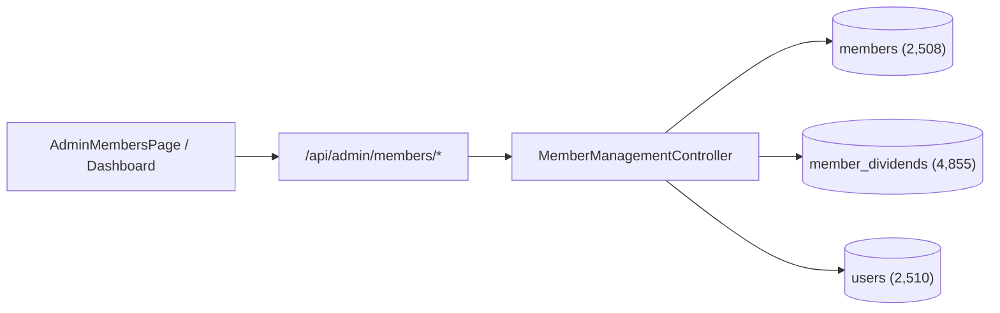

# RYCOOPWEB — API TO DATABASE MAPPING SPECIFICATION

**Repository:** `pharmacisttom/rycoopweb`
**Database:** `rayongcoop_db` (MySQL 8)
**Environment:** TEST ONLY
**Audit Date:** 2026-11-07

---

## 1. Schema & Table Directory

The database `rayongcoop_db` contains **60 verified tables**. The operational administrative modules map directly to the following authoritative tables:

| Module Name | MySQL Table | Total Rows | Primary Key | Status Column | Soft Delete Column | Notes |
|---|---|:---:|---|---|---|---|
| Members | `members` | 2,508 | `id` | `status` (`active`, `resigned`, `suspended`) | None (uses status) | Authoritative member master |
| Dividends | `member_dividends` | 4,855 | `id` | None | None | Historical annual dividends |
| Users & Auth | `users` | 2,510 | `id` | `status` (`active`, `inactive`, `suspended`) | `deleted_at` | Staff and member auth accounts |
| User Roles | `user_roles` | 2,510 | Composite | None | None | User-role associations |
| Roles | `roles` | 11 | `id` | None | None | Master roles (`super_admin`, etc.) |
| Permissions | `permissions` | 276 | `id` | None | None | Granular module.action matrix |
| Role Permissions | `role_permissions` | 276 | Composite | None | None | Role to permission mapping |
| Hero Slides | `hero_slides` | 3 | `id` | `status` (`active`, `inactive`) | `deleted_at` | Homepage banners |
| Popups | `popups` | 0 | `id` | `status` (`active`, `inactive`, `scheduled`) | `deleted_at` | Popup campaigns (Migration 029) |
| Welfare | `welfare` | 3 | `id` | `status` (`active`, `inactive`) | `deleted_at` | Member welfare schemes |
| E-Services | `eservice_links` | 5 | `id` | `status` (`active`, `inactive`) | `deleted_at` | Service gateway shortcuts |
| Boards | `boards` | 5 | `id` | `status` (`active`, `inactive`) | None (uses status) | Board directors & advisors |
| Staff | `staff` | 0 | `id` | `status` (`active`, `inactive`) | None (uses status) | Cooperative staff personnel |
| Loan Products | `loan_products` | 10 | `id` | `status` (`active`, `inactive`) | `deleted_at` | Loan product catalog |
| Deposit Products | `deposit_products` | 4 | `id` | `status` (`active`, `inactive`) | `deleted_at` | Deposit interest schemes |
| Document Categories| `document_categories` | 6 | `id` | `status` (`active`, `inactive`) | None (uses status) | Categories for documents |
| Documents | `documents` | 0 | `id` | `status` (`active`, `inactive`) | `deleted_at` | File downloads catalog |
| News | `news` | 2 | `id` | `workflow_status` | `deleted_at` | Cooperative press releases |
| Audit Logs | `audit_logs` | 136 | `id` | None | None | Administrative audit trail |
| Security Logs | `security_audit_logs`| 8 | `id` | None | None | Cryptographic & auth audit trail |

---

## 2. Detailed Endpoint to Database Mapping

### 2.1 Member Administration

- **`GET /api/admin/members/dashboard`**
  - Controller: `MemberManagementController@dashboard`
  - Tables: `members` (aggregates active/resigned/suspended), `member_dividends`, `users`
  - Output: Total members, active counts, recent join counts, dividend coverage.
  - Integrity Rule: Never hardcode member counts; read-only real aggregates.
- **`GET /api/admin/members`**
  - Controller: `MemberManagementController@index`
  - Tables: `members` joined with `users` and `roles`
  - Query: Filter by `q` (name, member_no, id_card), `status`, `department`, paginated 20/page.
- **`GET /api/admin/members/{id}`**
  - Controller: `MemberManagementController@show`
  - Tables: `members` WHERE `id = ?`, related dividends from `member_dividends`.
  - Integrity Rule: Citizen ID and sensitive PII are masked by default.

### 2.2 Content & CMS Modules

- **Hero Slides (`/api/admin/hero-slides`)**
  - Tables: `hero_slides`
  - Columns: `id`, `title`, `subtitle`, `desktop_image`, `mobile_image`, `link_url`, `link_target`, `sort_order`, `priority`, `status`, `created_at`, `updated_at`, `deleted_at`
  - Controller: `HeroSlideController` (`apiIndex`, `apiStore`, `apiUpdate`, `apiDestroy`)
- **Popups (`/api/admin/popups`)**
  - Tables: `popups`
  - Columns: `id`, `title`, `content`, `desktop_image`, `mascot_image`, `layout_mode`, `button_text`, `button_url`, `button_target`, `priority`, `priority_order`, `start_at`, `end_at`, `status`, `impressions_count`, `clicks_count`, `deleted_at`
  - Controller: `PopupController` (`apiIndex`, `apiStore`, `apiUpdate`, `apiDestroy`, `apiUpload`)
- **Welfare (`/api/admin/welfare`)**
  - Tables: `welfare`
  - Columns: `id`, `category`, `title`, `description`, `benefit_amount`, `eligibility_conditions`, `required_documents`, `icon`, `sort_order`, `status`, `created_at`, `updated_at`, `deleted_at`
  - Controller: `WelfareController` (`apiIndex`, `apiStore`, `apiUpdate`, `apiDestroy`)
- **E-Services Gateway (`/api/admin/eservices`)**
  - Tables: `eservice_links`
  - Columns: `id`, `name`, `url`, `description`, `icon`, `target`, `sort_order`, `status`, `created_at`, `updated_at`, `deleted_at`
  - Controller: `EServiceController` (`apiIndex`, `apiStore`, `apiUpdate`, `apiDestroy`)
- **Board & Staff Personnel (`/api/admin/board-staff`)**
  - Tables: `boards` (for directors, auditors, advisors) & `staff` (for administrative employees)
  - Columns `boards`: `id`, `name`, `role_type` (`director`, `auditor`, `advisor`), `position_title`, `department`, `photo`, `sort_order`, `status`, `term_start`, `term_end`, `created_at`, `updated_at`
  - Columns `staff`: `id`, `name`, `position_title`, `department`, `photo`, `email`, `phone`, `sort_order`, `status`, `created_at`, `updated_at`
  - Controller: `BoardStaffController` (`apiIndex`, `apiStoreBoard`, `apiUpdateBoard`, `apiDestroyBoard`, `apiStoreStaff`, `apiUpdateStaff`, `apiDestroyStaff`)
- **Products Catalog (`/api/admin/products` and alias `/api/admin/loans`)**
  - Tables: `loan_products` and `deposit_products`
  - Columns `loan_products`: `id`, `name`, `slug`, `category`, `interest_rate`, `min_amount`, `max_amount`, `max_term_months`, `features`, `conditions`, `sort_order`, `status`, `deleted_at`
  - Columns `deposit_products`: `id`, `name`, `slug`, `interest_rate`, `min_deposit`, `conditions`, `sort_order`, `status`, `deleted_at`
  - Controllers: `LoanProductController` and `DepositProductController`
- **Document Categories & Documents (`/api/admin/document-categories` and `/api/admin/documents`)**
  - Tables: `document_categories` and `documents`
  - Columns `document_categories`: `id`, `name`, `slug`, `description`, `sort_order`, `status`, `created_at`, `updated_at` *(Note: NO `deleted_at` or `icon`)*
  - Columns `documents`: `id`, `category_id`, `title`, `slug`, `document_number`, `file_path`, `file_size`, `file_type`, `year`, `tag`, `effective_date`, `download_count`, `sort_order`, `status`, `created_at`, `updated_at`, `deleted_at`
  - Controller: `DocumentController`

---

## 3. Discovered Schema Incompatibilities & Reconciliations

1. **`document_categories` soft delete**:
   Schema uses `status enum('active','inactive')`. All queries referencing `deleted_at IS NULL` must be updated to omit `deleted_at` or filter by `status = 'active'`. Deletion must update `status = 'inactive'` or delete record if no child documents exist.
2. **`document_categories.icon`**:
   Column does not exist in schema. Controller must omit `icon` from INSERT/UPDATE statements.
3. **`members.deleted_at`**:
   `members` table uses `status enum('active','resigned','suspended')`. Any query referencing `WHERE deleted_at IS NULL` must filter by `status != 'resigned'` or total count.
4. **`survey_responses.deleted_at`**:
   `survey_responses` table does not have `deleted_at`; survey responses are tracked by `submitted_at`.
