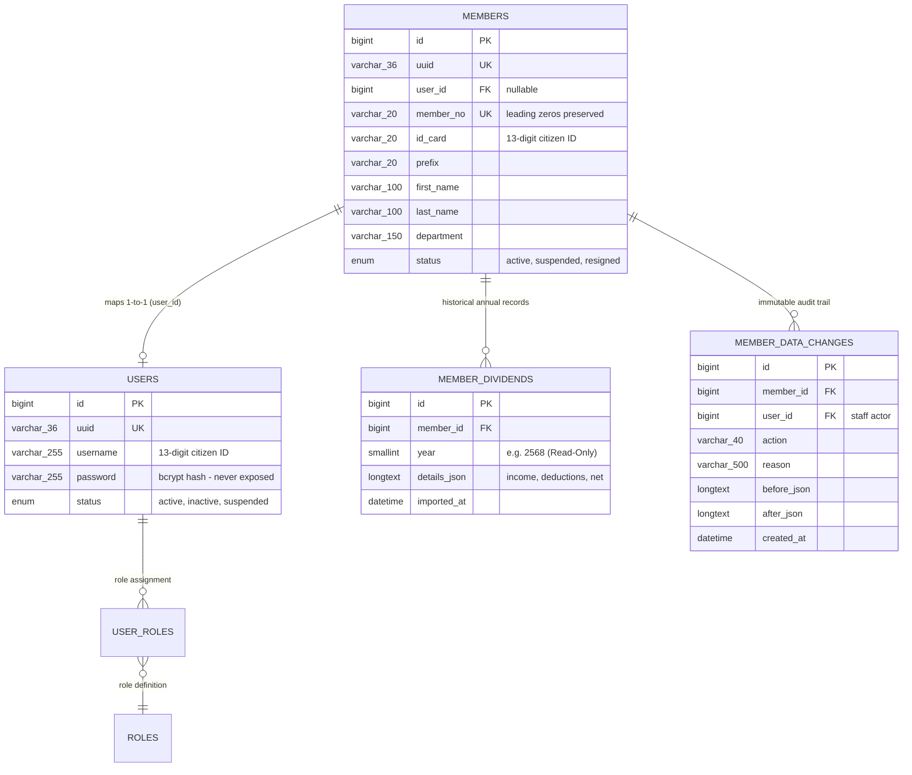
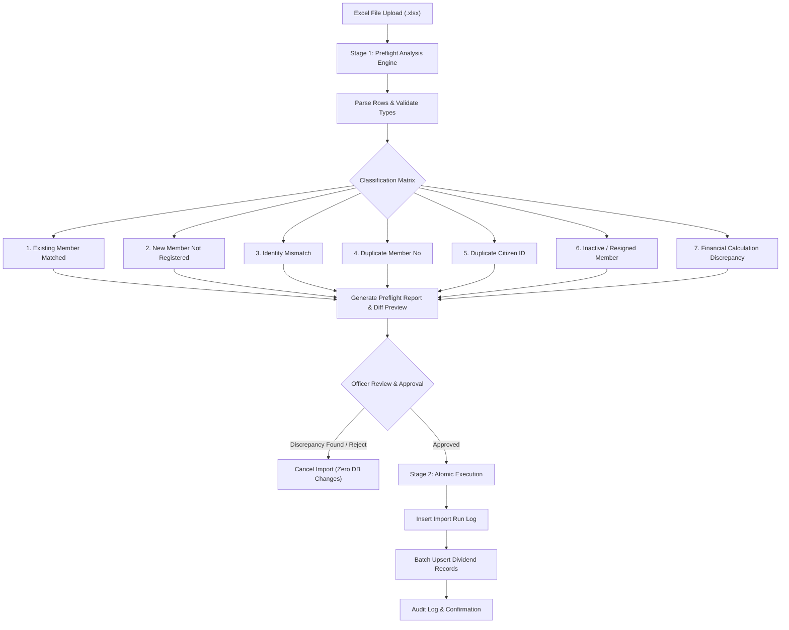

# RYCOOPWEB — MEMBER IDENTITY MAPPING & DATA SAFETY DESIGN

**Project:** RYCOOPWEB
**Specification:** Sprint 2B.1 Member Administration Platform
**Target Environment:** TEST ONLY (`test.rayongcoop.org`)
**Architecture:** Relational Identity Mapping, PDPA Masking, Dividend Immutability
**Status:** Approved for Implementation

---

## 1. Executive Overview

The Member Administration Platform manages over 2,500 cooperative members. A critical challenge in cooperative software engineering is maintaining strict separation between **Cooperative Membership Master Data** (the official institutional record) and **Digital Portal User Accounts** (online authentication credentials), while ensuring absolute 1-to-1 identity mapping integrity, PDPA compliance, and financial data immutability.



---

## 2. One-to-One Identity Mapping Architecture

### 2.1 The Mapping Model
- **Master Record:** `members` table is the definitive record of cooperative membership.
- **Digital Account:** `users` table handles web authentication, session tokens, and passwords.
- **Linkage:** `members.user_id` stores the foreign key reference to `users.id`.
- **Primary Identifier:** `members.member_no` is unique across the entire cooperative.
- **Login Username:** `users.username` is configured to match the member's 13-digit Citizen ID (`id_card`).

### 2.2 Invariant Guarantees
1. **Single Account per Member:** A member can have at most one user account.
2. **Single Member per Account:** A user account can be assigned to at most one member record.
3. **Role Separation:** A user account linked to a member record must hold the `member` role and cannot hold staff or administrator roles. Staff roles (`super_admin`, `manager`, `finance`, `staff`) must never be activated or edited through the member admin interface.
4. **Zero Auto-Creation:** Importing dividend files or browsing member records never automatically creates user accounts. Digital accounts are provisioned exclusively through authorized, verified workflows.

---

## 3. Leading Zero Preservation Policy

### 3.1 Technical Rationale
Cooperative member numbers are formatted with leading zeros (e.g., `00004`, `00006`, `00042`, `001234`). Converting these values to integers causes leading zero loss (`4`, `6`, `42`, `1234`), breaking legacy paper records, passbooks, and official cooperative communications.

### 3.2 Implementation Standards
1. **Storage Type:** Defined strictly as `VARCHAR(20)` in MySQL.
2. **Zero-Padding on Normalization:** When member numbers are saved or updated, values are normalized using `str_pad($no, 5, '0', STR_PAD_LEFT)`.
3. **Typography & UI Display:**
   - Displayed in tabular views using monospace typography (`.member-no-mono`, font family: `'SFMono-Regular', Consolas, 'Liberation Mono', Menlo, monospace`).
   - Monospace font ensures digit width alignment across large data tables.
4. **Search Compatibility:** Searching by `00004` or `4` uses SQL `LIKE ?` with `%` wildcard matching to allow flexible lookups without stripping stored zeroes.

---

## 4. Identity Safety & Anomaly Detection

The Member Administration interface provides real-time diagnostic checks for identity anomalies:

### 4.1 Duplicate Detection Rules
- **Member Number Uniqueness:**
  ```sql
  SELECT COUNT(*) FROM members WHERE member_no = ? AND id <> ?;
  ```
- **Citizen ID Uniqueness:**
  ```sql
  SELECT COUNT(*) FROM members WHERE id_card = ? AND id <> ?;
  ```
- When an anomaly is detected, the UI immediately displays a prominent warning badge and diagnostic alert, alerting the officer before any further action is taken.

### 4.2 Account Linkage Statuses
| Status Badge | Indicator | Description |
| :--- | :--- | :--- |
| **มีบัญชีแล้ว (Linked)** | Green checkmark | Member record is linked to an active digital account (`user_id IS NOT NULL`). |
| **ยังไม่มีบัญชี (Unlinked)** | Neutral gray | Member is registered in the cooperative but has not activated a digital portal account. |
| **ระงับการใช้งาน (Suspended)** | Orange warning | Member or linked account is temporarily suspended by cooperative policy. |

---

## 5. PDPA & PII Protection Standards

### 5.1 Masking Rules
To comply with the Personal Data Protection Act (PDPA):
1. **Citizen ID Masking:**
   - Full format: `3-2199-00100-95-9` (13 digits)
   - Masked format: `3-****-*****-[last 3 digits]` (e.g. `3-****-*****-95-9`) or `x-xxxx-xxxxx-xx-x`.
   - Projection: Handled via `App\Services\PdpaService::maskIdCard()`.
2. **Member Name Masking:**
   - Default format: First 2 characters shown, remaining name characters masked, first 4 characters of surname shown (e.g. `ทอxx วิศิxxx`).
   - Projection: Handled via `App\Services\PdpaService::maskName()`.
3. **Toggle Control:**
   - An authorized officer can click `แสดงข้อมูลตัวเต็ม` on the Member Detail screen to reveal unmasked data.
   - The unmasking action is backed by mandatory audit logging.

### 5.2 Secret Isolation
- **Password Hashes:** Excluded from all SQL SELECT queries across member endpoints.
- **TOTP Secrets & Session Keys:** Excluded from all API responses.
- **API Payloads:** Serialized objects contain only business fields required for administrative review.

---

## 6. Future Excel Preflight Design (FY 2569 Import)

To prepare for future annual dividend cycles (such as FY 2569) without risking database corruption or duplicate records, a **Two-Stage Preflight & Import Architecture** is designed:



### 6.1 The 7 Preflight Classification Categories

| Category | Definition | System Action |
| :--- | :--- | :--- |
| **1. Existing Member Matched** | Both `member_no` and `id_card` match an active member in the database. | Allowed for dividend record creation/update. |
| **2. New Member Not Registered** | Member no or citizen ID is present in the Excel file but absent from `members` table. | Flagged for manual review. Zero automatic account creation. |
| **3. Identity Mismatch** | Matches `member_no` but citizen ID or name differs from master record. | Blocked. Requires officer investigation before proceeding. |
| **4. Duplicate Member No** | The uploaded spreadsheet contains multiple rows with the same member number. | Blocked. Excel must be corrected before re-upload. |
| **5. Duplicate Citizen ID** | The spreadsheet contains multiple rows sharing the same citizen ID. | Blocked. Duplicate citizen IDs violate 1:1 mapping. |
| **6. Inactive / Resigned Member** | Member matches a database record whose status is `resigned` or `suspended`. | Flagged for administrative verification. |
| **7. Financial Discrepancy** | `total_income - total_deductions != net` in the spreadsheet row. | Blocked. Rejects rows where income minus deductions does not equal net. |

### 6.2 Atomic Execution Guarantee
- Preflight analysis runs entirely in memory without writing to database tables.
- Execution runs inside a single database transaction (`$pdo->beginTransaction()`).
- If any row encounters a fatal validation failure or database error, the entire batch rolls back (`$pdo->rollBack()`), leaving existing financial balances untouched.
