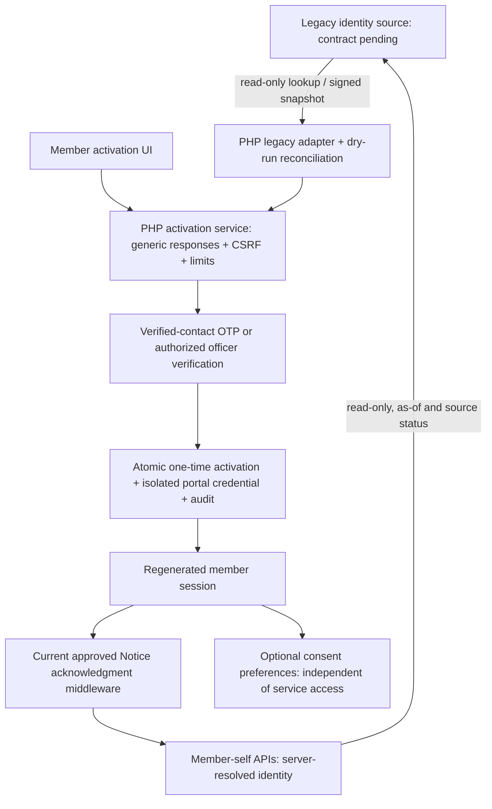

# Tomvis member integration — proposed plan and compatibility contract

This is a design proposal, not a claim of an existing Tomvis schema or completed integration. Read `docs/audit/TOMVIS_MEMBER_AUDIT.md` first. Use the user's named branch `codex/tomvis-member-auth-integration`; the attached alternate branch name describes the same follow-on work and is not a second implementation.

## Safest integration decision

Keep PHP as the member authentication/session authority and staff Google/TOTP authority. Prefer an owner-approved read-only Tomvis API for data. If unavailable, use a dedicated least-privilege read-only connector or signed, schema-validated snapshot with dry-run reconciliation. Do not share broad cross-subdomain cookies, collect legacy passwords in React for forwarding to arbitrary hosts, write financial balances, or run Prisma synchronization against legacy tables.

First determine whether both sites already share PHP accounts. If they share an active legacy users.password, a new portal password must **not overwrite it**: use a separate portal credential bound to the existing verified member/account, or an explicitly approved existing-auth flow. If separate systems, retain the legacy verifier/store untouched and map stable IDs through the approved adapter. Quarantine accounts mapped to staff or conflicting active accounts; never change staff roles to member to resolve a collision.

## Logical data mapping specification

The left-hand source fields are **logical concepts with actual Tomvis columns TBD**. Local candidate names are source-code evidence only, not live database certification.

| Logical legacy value | Local candidate / proposed rule |
|---|---|
| Stable legacy member ID | Mapping(source_system, legacy_member_id) -> local members.id, immutable and unique |
| Legacy account ID | Separate string identifier -> existing users.id only after verified role/binding reconciliation |
| Member number | Canonical five-character decimal string, preserve zeros; longer/ambiguous values quarantined, never truncated |
| National ID | 13-character string; normalize/check format and checksum when applicable; encrypted at rest with restricted access and keyed lookup digest; never audit the raw value |
| Name/status/contact | Match/reconcile attributes, not sufficient authority to link; only verified source contact can receive activation OTP |
| Financial records | Approved read-only payloads containing source record ID, owner mapping, currency/decimal strings, as-of timestamp and reconciliation reference; missing data remains unavailable |
| Existing account credentials | Preserve unchanged; no plaintext import, password reset, rehash or account creation during dry-run |

One-to-one invariants: unique (source_system, legacy_member_id), unique target member, unique target portal account. Do not force uniqueness on inconsistent legacy data by merging rows. Emit aggregate discrepancy counts and opaque case IDs, not national IDs. Manual reconciliations need authorized maker/checker review and audit.

## Proposed activation and login contract

Names below are proposed new APIs, not discovered routes. All are feature-gated, same-origin HTTPS and no-store. Mutations require CSRF. Limits use distributed/shared storage and keyed identity digests; avoid raw ID in rate keys/logs.

| Proposed endpoint | Contract |
|---|---|
| POST /api/member/activation/start | National ID + five-digit member number; generic 202/opaque challenge regardless of match; no profile/balance/contact disclosure |
| POST /api/member/activation/verify | Opaque challenge + OTP; bounded attempts, expiry, single-use verifier; no authentication from two legacy identifiers alone |
| POST /api/member/activation/complete | Verified challenge + new password; atomic account/binding/credential/audit, consume challenge, rotate session; never overwrite active legacy credentials |
| POST /api/member/auth/login | Member credential path; never grants staff roles; CSRF, shared rate limits, generic errors and session rotation |
| GET /api/member/privacy/notice | Approved notice metadata/content/hash/version/effective date only, no personal/financial payload |
| POST /api/member/privacy/acknowledgments | Server-selected current approved notice version; idempotent append-only acknowledgment; rejects stale versions |
| GET/POST /api/member/privacy/preferences | Versioned optional purposes; explicit opt-in/decline/withdraw events; withdrawal does not disable necessary services |
| POST /api/member/recovery/start, verify, complete | Generic responses, verified channel or authorized officer case, expiring one-time verifier, credential update + revoke sessions + atomic audit |

OTP TTL, attempt limits, support-proof requirements and lockout policy are configuration proposals to approve and test; no provider, destination or credential is assumed. Challenges store secure verifier hashes, never plaintext OTP. Browser storage/analytics must never contain national ID, password, OTP, token or recovery material. Logs use internal IDs and correlation IDs only.

## PDPA notice and consent model

Do not generate an unapproved legal notice and label it compliant. Required notice fields: controller, categories, purposes, lawful bases supplied by the controller, recipients, retention, rights, complaint/DPO contacts, full document URL, immutable version/content hash and effective date.

Required acknowledgment and optional consent are separate records and gates. Proposed logical entities: approved notice revisions; member notice acknowledgments; versioned optional purposes; append-only consent events; activation/recovery challenges; legacy identity mappings; verification cases; isolated portal credentials if needed. Actual additive SQL is deferred until source schema, FK types and storage/key policy are confirmed. Do not create migration filenames or execute migrations on a guessed schema.

All personal/financial endpoints, exports and documents must enforce the current acknowledgment on the server before reading data. React also routes to the notice screen, but it is not the security boundary. A new approved notice version requires acknowledgment again. Optional checkboxes are never preselected. Withdrawn marketing permission must not block profile/financial services. Administrative notice publication and verification overrides require scoped RBAC, fresh MFA and audit; no officer can activate on personal assertion alone.

## Phases and acceptance gates

1. **Audit / compatibility gate:** owner confirms legacy source/revision, shared-vs-separate database, schema-only metadata, verifier contract, OTP workflow and approved notice. No auth code or migration before this gate.
2. **Reconciliation dry-run:** adapter validates schema/types/collation/FKs without writes; duplicate IDs/member numbers/user bindings reported as opaque cases. Compare totals/as-of references without changing balances. Reviewer approves mapping.
3. **Implementation behind disabled flags:** separate member controller/service, challenge/recovery flow, notice/consent middleware, accessible Thai UI and account-administration screens. Reuse existing PHP session, RBAC, CSRF, rate limiter and required audit. Preserve PR Google/MFA and reviewed dependencies #10–#12/CRUD recovery.
4. **Developer/disposable MySQL 8 QA:** actual routes/controllers and MySQL constraints, concurrent activation/acknowledgment, audit rollback, no duplicate account creation, OTP failure/expiry/replay, reset/revocation, optional consent decline/withdraw, stale notice, IDOR across two synthetic members, 401/403/419, lockout, uploads/documents and failure states. Fixtures/mock UI alone do not certify readiness.
5. **Limited HTTPS TEST UAT:** separate database and approved release; only allowlisted synthetic pilot accounts behind existing gateway and backend flags. Test frontend and backend flags independently, direct APIs, new notice publication, all self-only financial/document requests and staff/MFA regression. No global activation.
6. **Authorized pilot, then separate Production approval:** confirm reconciliation, approved notice/provider configuration, retention/support responsibilities, backups and rollback evidence. This plan authorizes neither deployment nor changes to real accounts.

## Schema / SQL compatibility checks

Before an additive migration proposal: inspect schema-only metadata on both systems; compare account/member key widths and signedness, string collation and leading zeros, enum states, unique constraints and nullable bindings. Confirm a single owner for sessions/credentials and source-of-truth balances. Existing PHP members.user_id is a candidate link, not proof of one-to-one integrity. Next Prisma String IDs must not be cast to PHP integers or migrated into legacy tables.

Critical existing blockers: PHP MemberPortalService fabricates missing share values/deduction components; auth logs may contain national-ID usernames; member login defaults on independently of the full portal; cookie consent does not implement an authenticated notice gate. Resolve and test each before enabling access. Missing ledger data must produce explicit unavailable state, not zero or synthetic balances.

## TEST deployment / rollback proposal

Build a new immutable release only after PR review and explicit deployment approval; verify frontend/backend SHA, approved schema plan and separate TEST configuration. Keep .env/APP_KEY/MFA keys untouched. No changes to live TEST symlinks in this development task. Do not rerun 025; 019/020 ON HOLD; BACKUP_RESTORE_EXECUTION_ENABLED=false.

Rollback first closes the pilot via an approved backend gate, then restores the prior matching backend/frontend release. Revoke only authorized TEST pilot sessions. Preserve append-only acknowledgments/consent/activation audits; do not roll back legal evidence, delete mappings or restore financial databases to undo code. Any down migration/data repair requires separate authorization. Never reset legacy/staff credentials as rollback.

## Current readiness

**Not ready to reactivate.** Public reachability and local source audit are complete; authoritative legacy schema, deployment identity, verified OTP/officer policy and approved notice remain missing. No live balances/accounts were accessed or changed, no member auth implementation or migration was written, and no flags were enabled.
