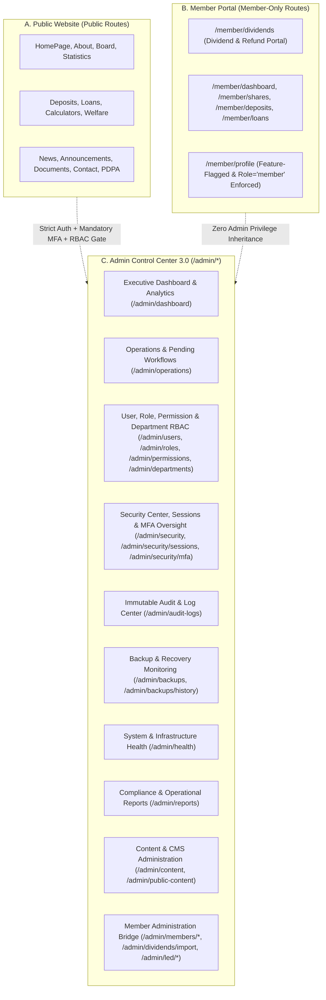

# RYCOOPWEB 3.0 — Enterprise Admin Control Center Architecture & Repository Audit

**Organization**: Rayong Public Health Savings and Credit Cooperative Limited (สหกรณ์ออมทรัพย์สาธารณสุขระยอง จำกัด)  
**Repository**: `pharmacisttom/rycoopweb`  
**Integration Baseline**: `Test` (`2d400a7`) + MFA QR Fix (`5cbdfa8` on `codex/fix-mfa-qr`)  
**Development Branch**: `codex/admin-control-center`  
**Status**: Implemented in Phased, Non-Destructive Architecture (Zero Unapproved Migrations Executed)

---

## 1. Mandatory Initial Repository Audit

### 1.1 Active Baseline & Pending Security Hotfix Reconciliation

| Branch / Commit | Summary | Status in `codex/admin-control-center` |
| :--- | :--- | :--- |
| `Test` (`2d400a7`) | MFA rate limit schema compatibility & concurrency (`MfaRateLimiter`, `MfaController`) | **Preserved (Base History)** |
| `codex/fix-mfa-qr` (`5cbdfa8`) | Scannable SVG MFA QR generation via `bacon/bacon-qr-code` 3.1.1 & round-trip decode tests (`QrCodeGenerator`, `MfaPage.jsx`, `QrCodeRoundTripTest.mjs`) | **Preserved & Integrated (Branch Head Base)** |
| `Test` (`ff23847` / `e3af75c`) | Three-way hotfix reconciliation & TEST staging validation (`97d0d03`) | **Preserved** |
| Migrations `019` & `020` | Legacy interest rate cleanup & deposit rate sync | **ON HOLD (Gated by `--confirm-financial`, Not Executed)** |

### 1.2 Existing Backend Infrastructure Audited

- **Routing & Dispatch**: `app/Core/Router.php`, `config/routes.php` — supports grouped prefixes, route parameters, and stacked middleware (`AuthMiddleware`, `RoleMiddleware`, `PermissionMiddleware`, `CsrfMiddleware`, `RateLimitMiddleware`, `FeatureFlagMiddleware`).
- **Authentication & Session Security**:
  - `app/Core/Auth.php` & `app/Core/Session.php` — 3-stage session state (`checkPendingMfaEnrollment()`, `checkPending2FA()`, full `Auth::check()`), `session_version` instant revocation, 20-minute inactivity timeout, 2-hour absolute lifetime.
  - `app/Controllers/Admin/GoogleAuthController.php` & `app/Services/GoogleAuthService.php` — Google OIDC with PKCE (`S256`), cryptographic `state`/`nonce`, immutable `google_sub` binding in `user_google_identities`, and one-time Super Admin bootstrap.
  - `app/Controllers/Admin/MfaController.php` & `app/Services/TwoFactorService.php` — AES-256-GCM encrypted TOTP secrets, replay protection via `two_factor_last_used_slice`, 8 single-use hashed recovery codes (`user_mfa_recovery_codes`), and local SVG QR code rendering (`QrCodeGenerator.php`).
- **Access Control & Staff Management**:
  - `app/Services/AccessService.php` & `app/Controllers/Admin/AccessController.php` — optimistic concurrency version hashes (`SHA-256`), last-active `super_admin` protection (`FOR UPDATE` row locking), and role/permission CRUD.
  - `app/Controllers/Admin/StaffManagementController.php` & `app/Services/StaffInvitationService.php` — staff listing with MFA/Google link status, expiring staff invitations (`staff_invitations`), account suspension/activation, session revocation, and security overview metrics.
- **Audit, Backup & Health**:
  - `app/Services/AuditService.php` — records structured audit entries into `audit_logs` and file logs via `App\Core\Logger`.
  - `app/Controllers/Admin/BackupController.php` & `bin/console` (`backup:run`, `cron:run`) — manages backups in `storage/backups` (outside `public/`) with `.sha256` digests.
  - `app/Services/MemberSystemHealth.php` — read-only schema & PHP extension health inspector.

### 1.3 Existing Frontend Components Audited & Reuse Plan

| Existing File | Role in Current System | Reuse Strategy in Admin Control Center 3.0 |
| :--- | :--- | :--- |
| `src/App.jsx` | SPA router, `StaffProtectedRoute`, public/member/admin layout switching | Extend with `/admin/*` Control Center routes while preserving all existing routes and test contracts |
| `src/context/AuthContext.jsx` | Session state, background heartbeat (no form unmount), `can(permission)` | Reuse directly as single source of frontend auth & permission checks |
| `src/context/ThemeContext.jsx` | Light/Dark theme persistence (`data-theme="dark"`) | Reuse in `AdminControlCenterShell` header & sidebar |
| `src/components/dashboard/*` | `KpiCard`, `SectionHeader`, `StatusBadge`, `EmptyState`, `DashboardHeader` | Reuse & complement with enterprise KPI cards, SVG charts, and status badges |
| `src/pages/AdminDashboardPage.jsx` | Legacy 8-tab CMS & Cooperative admin page | Preserve at `/admin/cms-legacy` & integrate CMS tabs into `/admin/content` while upgrading `/admin/dashboard` into the Executive Control Center |
| `src/pages/AdminAccessPage.jsx` | Role & staff user CRUD with optimistic locking | Reuse & embed inside Control Center Access routes (`/admin/users`, `/admin/roles`, `/admin/permissions`) |
| `src/pages/AdminWorkspacePage.jsx` | Permission-aware staff workspace landing page | Preserve `/admin/workspace` contract for existing staff/custom roles and link seamlessly into Control Center |
| `src/components/member/AdminMemberShell.jsx` | Dedicated Member Admin shell (`/admin/members/*`, `/admin/dividends/import`) | Preserve intact and cross-link with Admin Control Center |
| `src/pages/PublicContentAdminPage.jsx` & `ContentAdminPage.jsx` | Draft/review/publish CMS workflows | Preserve routes and embed navigation within Control Center Content Management |

---

## 2. Three-Tier Logical Application Separation



---

## 3. Admin Control Center Route Map

| Route Path | Component / View | Required Access Policy | Purpose |
| :--- | :--- | :--- | :--- |
| `/admin` | `AdminControlCenterPage` (`dashboard`) | `super_admin` or `dashboard.view` | Executive Control Center entry |
| `/admin/dashboard` | `AdminControlCenterPage` (`dashboard`) | `super_admin` or `dashboard.view` | Executive KPIs, 30-day trends & analytics |
| `/admin/operations` | `AdminControlCenterPage` (`operations`) | `super_admin` or staff/permission | Pending tasks, member profile requests, complaints, drafts, LED runs |
| `/admin/users` | `AdminControlCenterPage` (`users`) | `super_admin` or `users.view` | Staff accounts, Google OIDC link status, invitations & role assignment |
| `/admin/roles` | `AdminControlCenterPage` (`roles`) | `super_admin` or `roles.view` | Role catalog, built-in vs custom roles, reconciled enterprise role matrix |
| `/admin/permissions` | `AdminControlCenterPage` (`permissions`) | `super_admin` or `permissions.manage` | Granular module-action permission matrix & role mapping |
| `/admin/departments` | `AdminControlCenterPage` (`departments`) | `super_admin` or `users.view` | Cooperative department directory, staff allocation & pending work |
| `/admin/security` | `AdminControlCenterPage` (`security`) | `super_admin` or `security.view` | Transparent Security Health Score, failed logins, lockouts, security config |
| `/admin/security/sessions` | `AdminControlCenterPage` (`sessions`) | `super_admin` or `security.view` | Sanitized session version metadata & instant session revocation |
| `/admin/security/mfa` | `AdminControlCenterPage` (`mfa`) | `super_admin` or `security.view` | Mandatory MFA coverage, enrollment dates, remaining recovery-code counts |
| `/admin/audit-logs` | `AdminControlCenterPage` (`audit-logs`) | `super_admin` or `audit.view` | Sanitized, redacted audit trail, authentication logs & CSV export |
| `/admin/backups` | `AdminControlCenterPage` (`backups`) | `super_admin` or `backup.view` | Read-only backup overview, storage utilization, SHA-256 verification status |
| `/admin/backups/history` | `AdminControlCenterPage` (`backups-history`) | `super_admin` or `backup.view` | Backup archive inventory, retention status & restore governance policy |
| `/admin/health` | `AdminControlCenterPage` (`health`) | `super_admin` or `system.health.view` | PHP-FPM, MySQL, schema readiness, disk/memory & scheduled task monitoring |
| `/admin/reports` | `AdminControlCenterPage` (`reports`) | `super_admin` or `finance.view` / `audit.view` | Operational, security, member & financial summary reports with CSV export |
| `/admin/settings` | `AdminControlCenterPage` (`settings`) | `super_admin` or `settings.view` | System configuration, security posture, profile & password settings |
| `/admin/cms` | `AdminDashboardPage` | `super_admin` or staff roles | Full 8-module Cooperative CMS & Rate Manager |
| `/admin/workspace` | `AdminWorkspacePage` | Authenticated non-member staff | Existing permission-aware staff workspace (preserved for backward compatibility) |
| `/admin/access` | `AdminAccessPage` | `super_admin` | Existing direct role/account manager (preserved & linked from `/admin/roles`) |
| `/admin/public-content` | `PublicContentAdminPage` | `coop_info.view` / `people.view` / `rates.view` / `products.view` | Maker-checker public content revision manager |
| `/admin/content` | `ContentAdminPage` | `news.view` / `faqs.view` | News & FAQ workflow manager |
| `/admin/members/*` | `AdminMembers*Page` | `members.view` | Dedicated Member & Dividend Administration |

---

## 4. Backend API Architecture (`/api/admin/*`)

All Admin Control Center APIs are served by `App\Controllers\Admin\ControlCenterApiController` and `App\Services\AdminControlCenterService` with:
- Strict authentication (`AuthMiddleware` enforcing full 2FA completion).
- Granular permission or `super_admin` authorization checks on every endpoint.
- Prepared SQL statements, bounded `LIMIT`/`OFFSET` pagination, and bounded date windows (`7d`, `30d`, `90d`).
- Correlation ID (`X-Correlation-Id`) returned in response headers and JSON envelopes.
- Automatic secret redaction (`password`, `two_factor_secret`, `code_hash`, `token_hash`, cookies, tokens) before serialization.

| Endpoint | Method | Guard | Description |
| :--- | :--- | :--- | :--- |
| `/api/admin/dashboard/summary` | `GET` | `super_admin` or `dashboard.view` | Real 12-KPI executive summary, honest `"ยังไม่มีข้อมูล"` / `"ไม่พร้อมใช้งาน"` indicators |
| `/api/admin/dashboard/trends` | `GET` | `super_admin` or `dashboard.view` | 30-day login trends, successful vs failed logins, user activity by module, MFA coverage by role, pending work by department |
| `/api/admin/analytics/usage` | `GET` | `super_admin` or `analytics.view` | Visitor & module usage analytics, storage usage breakdown, backup trend |
| `/api/admin/operations/overview` | `GET` | `super_admin` or staff | Pending member requests, draft news, open complaints, public content drafts, LED runs |
| `/api/admin/security/overview` | `GET` | `super_admin` or `security.view` | Rule-based Security Health Score, failed logins, lockouts, role changes, security config |
| `/api/admin/security/sessions` | `GET` | `super_admin` or `security.view` | Sanitized staff session metadata (`session_version`, `last_login_at`, `last_login_ip`) |
| `/api/admin/security/mfa` | `GET` | `super_admin` or `security.view` | Per-staff MFA status, enrollment timestamp, recovery-code count (never secrets/codes) |
| `/api/admin/audit-logs` | `GET` | `super_admin` or `audit.view` | Paginated, filterable, redacted audit & authentication logs (`category`, `severity`, `module`, `q`, `from`, `to`) |
| `/api/admin/backups` | `GET` | `super_admin` or `backup.view` | Read-only backup file inventory from `storage/backups`, SHA-256 checksum status, categories |
| `/api/admin/backups/health` | `GET` | `super_admin` or `backup.view` | Latest backup freshness, storage utilization, retention status & restore policy |
| `/api/admin/system/health` | `GET` | `super_admin` or `settings.view` | PHP-FPM, MySQL latency & table stats, member schema health, disk/RAM metrics, scheduled jobs |
| `/api/admin/departments` | `GET` | `super_admin` or `users.view` | Department summary, active staff count, member count & pending items |
| `/api/admin/reports/catalog` | `GET` | `super_admin` or `audit.view` / `finance.view` | Authorized report definitions & live summary datasets for CSV export |

---

## 5. Optional Non-Destructive SQL Migration Proposal (Not Executed)

In compliance with Section 11 and Section 15 ("Do not execute migrations automatically"), the Admin Control Center operates **100% against existing database tables** (`users`, `roles`, `permissions`, `user_roles`, `role_permissions`, `user_google_identities`, `staff_invitations`, `user_mfa_recovery_codes`, `audit_logs`, `login_logs`, `system_logs`, `site_settings`, `members`, `member_dividends`, `member_import_runs`, `member_data_changes`, `member_profile_requests`, `complaints`, `news`, `public_content_revisions`, `financial_statistics`, `led_check_runs`).

If persistent preferences, saved report presets, or durable backup/restore approval records are desired in a future database release, the following additive-only schema proposal is documented for DBA review:

```sql
-- PROPOSED ONLY — DO NOT EXECUTE AUTOMATICALLY
-- File reference: docs/architecture/ADMIN_CONTROL_CENTER.md

CREATE TABLE IF NOT EXISTS `admin_dashboard_preferences` (
    `id` BIGINT UNSIGNED AUTO_INCREMENT PRIMARY KEY,
    `user_id` BIGINT UNSIGNED NOT NULL UNIQUE,
    `sidebar_collapsed` TINYINT(1) NOT NULL DEFAULT 0,
    `pinned_widgets_json` JSON DEFAULT NULL,
    `default_date_range` VARCHAR(20) NOT NULL DEFAULT '30d',
    `updated_at` DATETIME NOT NULL DEFAULT CURRENT_TIMESTAMP ON UPDATE CURRENT_TIMESTAMP,
    CONSTRAINT `fk_admin_pref_user` FOREIGN KEY (`user_id`) REFERENCES `users` (`id`) ON DELETE CASCADE
) ENGINE=InnoDB DEFAULT CHARSET=utf8mb4 COLLATE=utf8mb4_unicode_ci;

CREATE TABLE IF NOT EXISTS `restore_approval_requests` (
    `id` BIGINT UNSIGNED AUTO_INCREMENT PRIMARY KEY,
    `backup_filename` VARCHAR(255) NOT NULL,
    `backup_sha256` VARCHAR(64) NOT NULL,
    `requested_by` BIGINT UNSIGNED NOT NULL,
    `approved_by` BIGINT UNSIGNED DEFAULT NULL,
    `reason` TEXT NOT NULL,
    `status` ENUM('pending', 'approved', 'rejected', 'cancelled') NOT NULL DEFAULT 'pending',
    `created_at` DATETIME NOT NULL DEFAULT CURRENT_TIMESTAMP,
    `updated_at` DATETIME NOT NULL DEFAULT CURRENT_TIMESTAMP ON UPDATE CURRENT_TIMESTAMP,
    CONSTRAINT `fk_restore_req_user` FOREIGN KEY (`requested_by`) REFERENCES `users` (`id`) ON DELETE RESTRICT
) ENGINE=InnoDB DEFAULT CHARSET=utf8mb4 COLLATE=utf8mb4_unicode_ci;
```

