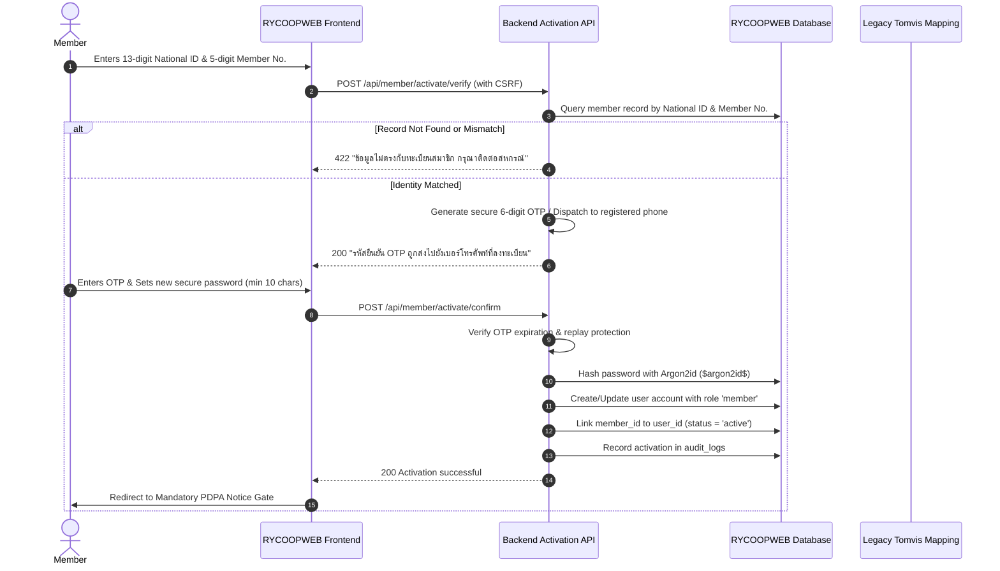

# Legacy Tomvis Member Portal Integration Audit & Technical Plan

Date: 2026-10-31  
Target System: Rayong Public Health Cooperative (RYCOOPWEB 3.0)  
Reference System: Tomvis Legacy System (`https://rayongcoop.tomvisolution.tech/`)

---

## 1. Executive Summary & Access Status

The legacy member portal at `https://rayongcoop.tomvisolution.tech/` served as the operational member database for checking member numbers, shares, deposits, loans, and annual dividend distributions.

> [!WARNING]
> **Direct Database & Source Code Access: BLOCKED**  
> As of this audit, direct database connection strings, credentials, and raw application source code for `tomvisolution.tech` are not provisioned in the repository environment.  
> In accordance with safety rules, no schema or internal password hashing mechanism for the Tomvis system is assumed or guessed.

---

## 2. Identified Data Architecture & Constraints

Based on official cooperative member conventions and existing legacy reference records in `src/data/legacyReference.json`:

1. **National Citizen ID (Primary Identifier)**:
   - Format: Exactly 13 digits numeric (`/^[0-9]{13}$/`).
   - String representation must preserve leading zeros.
   - Used as the unique member credential identifier in modern RYCOOPWEB.
2. **Cooperative Member Number (Verification Anchor)**:
   - Format: 5 digits numeric (e.g. `00123`, `08542`).
   - Must be stored as `VARCHAR(10)` to preserve leading zeros. Numeric conversion (`INT`) is strictly prohibited.
3. **Password Security Boundary**:
   - Plaintext passwords from the Tomvis system **must never be imported or stored** in RYCOOPWEB 3.0.
   - Any temporary passwords (such as 5-digit member numbers) used on legacy portals must be completely prohibited for permanent access to sensitive financial and dividend records.

---

## 3. Safe Member First-Time Account Activation Workflow

To transition members safely without compromising credentials or financial privacy, the following 9-step activation flow is designed:

### Safety Requirements for Activation:
1. **Rate Limiting**: Max 5 attempts per IP / National ID per 15 minutes.
2. **No Data Leakage**: Error messages must not reveal whether the National ID or Member Number specifically caused the mismatch.
3. **Authorized Officer Assisted Flow**: If a member's phone number has changed or SMS OTP is unavailable, identity verification must occur in-person or through an authorized cooperative staff workflow (`members.update` permission) with an audit trail.

---

## 4. Required Data Payload from Tomvis (Read-Only Export / API)

Before Member Portal reactivation can proceed in Production, the following verified dataset must be provided:

| Data Entity | Required Fields | Data Types | Security / Privacy Note |
|---|---|---|---|
| **Member Master** | `member_no`, `id_card`, `full_name`, `phone`, `org_name`, `status`, `registered_at` | `VARCHAR` | PII: Masked in logs; unique index on `id_card` and `member_no`. |
| **Share Capital** | `member_no`, `accumulated_shares`, `monthly_share_amount`, `share_balance_baht` | `DECIMAL(12,2)` | Financial balance: Read-only sync; zero direct modifications. |
| **Deposits** | `member_no`, `account_no`, `account_name`, `balance`, `interest_accrued` | `DECIMAL(12,2)` | Financial balance: Read-only snapshot. |
| **Loans** | `member_no`, `contract_no`, `loan_type`, `principal_balance`, `monthly_installment` | `DECIMAL(12,2)` | Financial balance: Read-only snapshot. |
| **Dividends** | `member_no`, `year`, `dividend_amount`, `patronage_refund`, `total_paid` | `DECIMAL(12,2)` | Reconciled via existing `DividendImportService`. |

---

## 5. Member Portal Feature Flag Gate

To prevent unauthorized or premature access prior to data sign-off:
- `features.member_portal`: Set to `false` (Default Deny).
- `features.member_login`: Set to `false` (Default Deny).
- `VITE_FEATURE_MEMBER_PORTAL`: Set to `"false"` in Vite build.
- Backend routes under `/member/*` and `/api/member/*` enforce `FeatureFlagMiddleware('member_portal')`. Attempts to access return HTTP 403 or redirect to `service-unavailable`.
