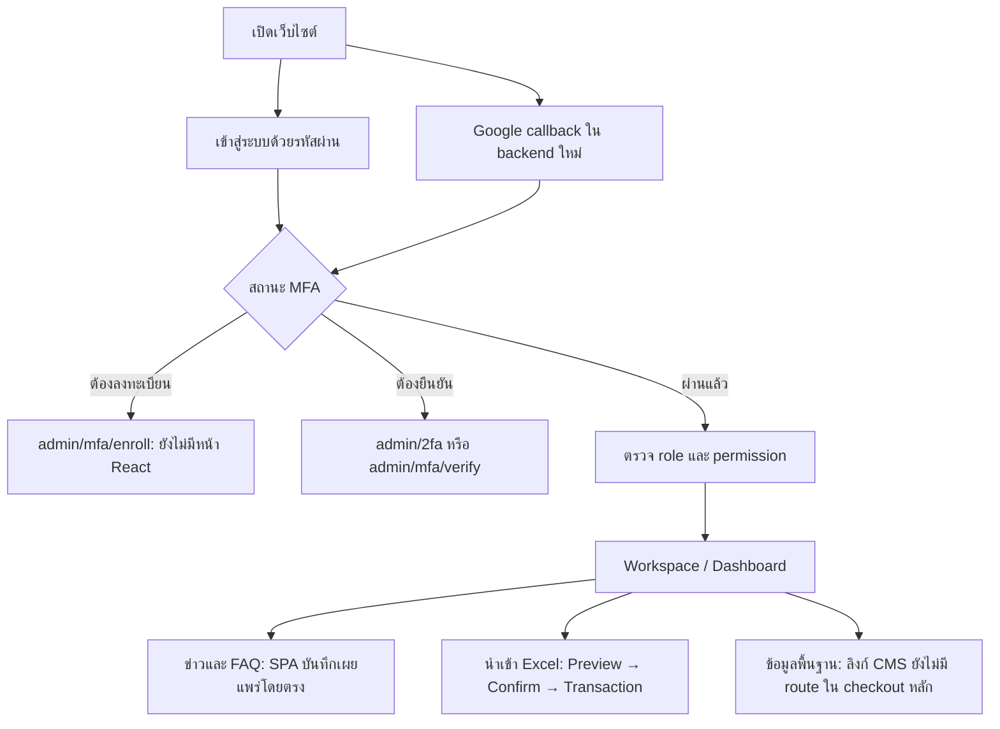
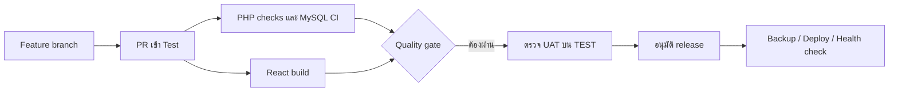

# ตรวจ workflow ของระบบ — 26 ตุลาคม 2569

ตรวจ checkout หลัก `D:\rycoopweb`, branch `codex/member-portal-integration`, HEAD `38031d9` รวมไฟล์แก้ค้างขณะตรวจ
source กำลังมีงาน Google/MFA/Staff เพิ่ม จึงต้องรันทดสอบซ้ำหลังรวม commit ไม่ถือว่าตรงกับ VPS
ตรวจ business workflow และ GitHub CI/deployment โดยไม่เปลี่ยน source, บัญชี, ฐานข้อมูล หรือ deploy

## ข้อสรุป

Build ผ่านและ handler PHP ที่ลงทะเบียนพบครบ แต่ workflow ผู้ใช้ยังไม่ครบ end-to-end
จุดติดหลักคือหน้า MFA/หลังบ้านบาง route ยังไม่มี, custom role ถูกปิดกั้นหลายชั้น และ CI ขัดกับค่าที่ tests คาด

## เส้นทางใช้งาน

## ผลตรวจแยก workflow

| ลำดับ | Workflow | สถานะ / หลักฐาน | ผลกระทบและสิ่งที่ต้องต่อ |
| --- | --- | --- | --- |
| 1 | Password / Google → MFA → Dashboard | Backend มี GoogleAuthController, MfaController และ API MFA ในงานยังไม่ commit; middleware ชี้ /admin/mfa/enroll และ /admin/mfa/verify แต่ App.jsx ไม่มี routes เหล่านี้; ยังไม่พบ Google login UI ใน LoginPage | ต้องเพิ่มหน้า enroll/verify/recovery และให้หน้า Login/AuthContext จัดการ MFA_ENROLLMENT_REQUIRED/TWO_FACTOR_REQUIRED ชุดเดียวกันก่อนเปิดใช้งาน |
| 2 | Legacy /admin/2fa | LoginPage ใช้ window.location.assign ไปยัง URL จาก backend ซึ่งเป็น full navigation; PHP AuthController ยังอ้าง view auth.two_factor | ต้องตรวจทั้ง PHP handler/view และ reverse proxy fallback ว่าถึงหน้าจริง; build React ผ่านไม่ยืนยัน legacy OTP page ทำงาน |
| 3 | สร้าง custom role → กำหนดสิทธิ์ → เข้าทำงาน | มี AccessService/AccessController/หน้า UI แต่ LoginPage ตรวจ STAFF_ROLES แบบรายชื่อคงที่, StaffProtectedRoute มี role allowlist และ backend news/faqs group บังคับ super_admin เพิ่มจาก PermissionMiddleware | ผู้มี permission อาจเข้าไม่ได้ ต้องกำหนดนโยบายว่าใช้ role AND permission หรือ permission-driven แล้วทำให้ Login/UI/API ตรงกัน ห้ามถอด guard เพื่อให้ผ่านอย่างเดียว |
| 4 | Workspace → CMS | AdminWorkspacePage มีลิงก์ /admin/public-content และ /admin/content แต่ App.jsx ใน checkout นี้ไม่มี route ตรงกัน | เปิดแล้วถึง 404; งาน CMS ใน worktree/branch แยกยังไม่ถูกผนวกครบ ห้ามอ้างว่ามีเมนูแล้ว workflow พร้อม |
| 5 | สมาชิกยื่นแก้ข้อมูล → แอดมินดูคำขอ → อนุมัติ | GET /api/admin/members/requests อยู่หลัง /{id}; ทดสอบ first-match แล้วเข้า MemberManagementController@show | รายการคำขอถูกอ่านเป็นรหัสสมาชิก ต้องย้าย static route ก่อน dynamic พร้อม dispatch regression test |
| 6 | ข่าวประชาสัมพันธ์ | PHP NewsController รับ workflow_status ได้ แต่ SPA createAdminNews INSERT เป็น published และ publish_at=NOW() | workflow draft → review → publish ยังไม่เป็นหนึ่งเดียว ต้องให้ UI/API ใช้สถานะ/สิทธิ์อนุมัติเดียวกันและตรวจ preview ก่อนเผยแพร่ |
| 7 | เปลี่ยนดอกเบี้ย → ประวัติ → ผลิตภัณฑ์ → หน้าเว็บ | updateAdminRate เขียน interest_rate_history แล้ว rates แล้ว sync loan_products/deposit_products โดยชื่อ/LIKE; ไม่พบ transaction ในเมธอด และ approved_by เป็นผู้แก้เอง | บางขั้นล้มอาจได้ข้อมูลคนละชุด; ยังไม่ใช่ maker-checker ต้องใช้ transaction, stable product relation และ approval; ตรวจวันที่มีผลกับ public query ก่อนแสดง |
| 8 | Excel → ตรวจไฟล์ → Preview → Confirm | มีการตรวจไฟล์/ปี/duplicate, token+expiry 30 นาที, database snapshots; confirm ใช้ transaction, row locks, rollback และล้าง preview token เมื่อสำเร็จ | โครงสร้างต่อกันแล้วตาม source แต่รอบนี้ไม่ได้ทำ HTTP/MySQL end-to-end; ต้องทดสอบ duplicate confirm, concurrent change, totals และ rollback ด้วย synthetic fixtures |
| 9 | Session checking / offline | AuthContext ตรวจพื้นหลังทุก 60 วินาทีเมื่อ visible และไม่ unmount form เมื่อ network ล่ม; frontend idle timeout 20 นาที ขณะที่ backend idle 30 นาที | เป็น background fetch ไม่ใช่ full refresh แต่เกณฑ์เวลาไม่ตรงกัน; ต้องกำหนดค่าเดียวและทดสอบ session expiry ระหว่างเปิดฟอร์ม |
| 10 | Backup → restore → ยืนยัน recovery | CLI backup เขียน dump ด้วย file_put_contents แต่ไม่ตรวจ false อย่างชัดเจน; ไม่พบ restore drill/checksum เป็น gate ของ deploy script | ขึ้นข้อความ backup สำเร็จไม่ได้รับรองกู้คืนได้ ต้องตรวจผลเขียนและทดสอบ isolated restore ก่อน live migration |

## GitHub / CI / Deployment

### สิ่งที่มีอยู่

- `.github/workflows/ci.yml` รันเมื่อ PR, push main/Test/codex/** และสั่งเองได้
- แยก PHP/MySQL job กับ React job; มี Composer validate, PHP lint, media/security checks, migrate และ seed สองรอบบน CI DB, public API smoke, build และ upload artifact
- ไม่พบขั้นตอน auto deploy ใน workflow นี้ ซึ่งสอดคล้องกับข้อกำหนดต้องอนุมัติ deployment

### จุดขัดข้องที่ยืนยันแล้ว

1. CI กำหนด FEATURE_MEMBER_LOGIN=false แต่ tests/SecurityRegressionTest.php คาด member_login=true แบบตายตัว: รันด้วย CI flags แล้ว exit 1 พร้อม FAIL หนึ่งรายการ ต้องแก้ test contract ให้เคารพ explicit flag โดยคงทดสอบ default/deny-by-default แยกกัน
2. CI ใช้ PHP 8.5 และ MySQL 8.4 ขณะที่เป้าหมายที่แจ้งคือ PHP-FPM 8.3/MySQL 8 ต้องมี matrix/compatibility ที่ตรง deployment จริง ไม่ใช้ green build บนเวอร์ชันอื่นแทนหลักฐาน
3. CI ยังไม่รัน Google OAuth/MFA enrollment/recovery/session revoke, role CRUD, financial import end-to-end และ browser E2E; green CI จึงยังไม่ใช่ Production readiness
4. bin/deploy-production.sh ใช้ path คงที่ /var/www/rayongcoop และดึง Test จากนั้น migrate/build ใน checkout ที่ใช้งานอยู่ ต้องยืนยัน path/branch จริง เตรียม release แยกก่อน switch และมีกระบวนการอนุมัติภายนอก script
5. deploy script ยังไม่ใช้ผล CI/artifact revision/UAT/restore เป็นเงื่อนไขบังคับ; migration มาก่อน build หาก build ล้มอาจเหลือ backend/schema เปลี่ยนแล้ว ต้องวาง compatibility และ rollback ก่อนรัน ไม่ได้รัน script นี้ในรอบตรวจ

## การตรวจที่รันจริง

| การตรวจ | ผล |
| --- | --- |
| Router reflection + class_exists/method_exists โดยไม่ dispatch controller | 280 registered routes; missing handlers 0 |
| First-match GET /api/admin/members/requests | เข้า @show แทน @requests — FAIL |
| SecurityRegressionTest ด้วย CI flags (member_portal=false, member_login=false) | exit 1; FAIL member login defaults to enabled for dividend access |
| npm run build | PASS; ยังไม่พิสูจน์เส้นทาง MFA ที่ไม่ได้ลงทะเบียนหรือ API authorization |
| ตรวจ literal React routes | ไม่พบ /admin/mfa/enroll, /admin/mfa/verify, /admin/public-content, /admin/content ใน App.jsx |

ไม่ได้รัน migrations, seed, restore, login จริง, ส่งคำเชิญ/อีเมล, OAuth ของบัญชีจริง หรืออ่านข้อมูลสมาชิก
ไม่ได้อ้างว่างานเก่าบน branch แยกผ่านใน checkout หลักแล้ว ต้อง integrate/retest ก่อน

## ลำดับแก้ที่เสนอ

1. รวม source/workflow ที่กระจายหลาย branch โดย checkpoint งานค้างก่อน และตกลง deployed revision ที่จะตรวจ
2. ปิดเส้นทางที่ขาดใน Login → MFA → Role/Permission → Workspace รวม error/expired/recovery/logout
3. แก้ route คำขอสมาชิกและ policy custom roles ให้ตรง UI/API พร้อม positive/negative tests
4. รวมข้อมูลกลางและ draft/review/publish สำหรับข้อมูลพื้นฐาน ข่าว และดอกเบี้ย ให้ traceable และมี transaction
5. ซ่อม CI contract เพิ่ม tests ที่ตรง runtime จริง แล้วทำ TEST/UAT ก่อน approval deploy

## เกณฑ์รับ workflow

- ทุกลิงก์ที่ผู้ใช้เห็นมี route และหน้าที่ทำงานจริง ไม่ใช่แค่ import/build ผ่าน
- ผู้ใช้ตาม role/permission ที่รับรองทำงานได้ ส่วนผู้ไม่มีสิทธิ์ถูกปฏิเสธทั้ง UI/API
- MFA enrollment/verify/recovery/expired/session revoke ผ่าน end-to-end ก่อนบังคับใช้
- ร่างไม่เปลี่ยนหน้าจริงจนอนุมัติ ข้อมูลอัตรา/ผลิตภัณฑ์และวันที่มีผลสอดคล้องกัน
- Import ล้มเหลวไม่เหลือข้อมูลบางส่วน และยอดรวมตรง independent synthetic reference
- CI ผ่านบน revision เดียวกับ artifact และมี UAT/backup/rollback/health checks ก่อน deploy

รายงานนี้ไม่แก้ source จึงไม่มี data/schema rollback; ห้าม reset งานค้างหรือรัน deployment จากข้อเสนอในเอกสารโดยอัตโนมัติ
