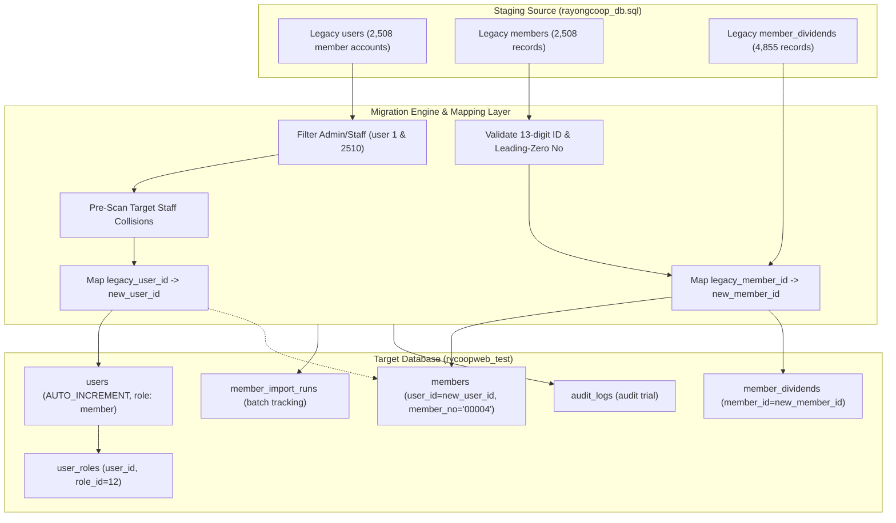

# RYCOOPWEB 3.0 — Legacy-to-New Field Mapping Specification

**Target Branch:** `codex/legacy-member-dividend-migration`

---

## 1. Mapping Flow Architecture

---

## 2. Entity Mapping Tables

### 2.1 Users Mapping
| Source Column (`users`) | Target Column (`users`) | Transformation / Rule |
| :--- | :--- | :--- |
| `id` | - | Re-mapped. Target database allocates new ID; legacy ID stored in mapping memory/run metadata. |
| `uuid` | `uuid` | Preserved or regenerated if format mismatch. |
| `name` | `name` | String trimmed; sanitized. |
| `department` | `department` | Nullable string preserved. |
| `username` | `username` | National 13-digit ID card. Confirmed non-colliding with staff. |
| `email` | `email` | Preserved (`member-XXXXX@members.invalid`). |
| `password` | `password` | Verified bcrypt hash `$2y$10$...`. Never converted to plaintext. |
| `status` | `status` | 'active' (protected behind `FEATURE_MEMBER_PORTAL=false`). |
| `session_version` | `session_version` | Initialized to `1`. |
| - | `created_at` | Timestamp of migration execution. |
| - | `updated_at` | Timestamp of migration execution. |

### 2.2 Members Mapping
| Source Column (`members`) | Target Column (`members`) | Transformation / Rule |
| :--- | :--- | :--- |
| `id` | - | Re-mapped. Target database allocates new ID; legacy ID stored in mapping. |
| `uuid` | `uuid` | Preserved or regenerated. |
| `user_id` | `user_id` | Target newly generated `users.id` resolved from `userMapping[legacy_user_id]`. |
| `member_no` | `member_no` | **Leading zeros strictly preserved** (`str_pad($val, 5, '0', STR_PAD_LEFT)` if numeric string). |
| `id_card` | `id_card` | 13-character string, verified format `/^\d{13}$/D`. |
| `prefix` | `prefix` | Preserved. |
| `first_name` | `first_name` | Preserved. |
| `last_name` | `last_name` | Preserved. |
| `department` | `department` | Preserved. |
| `status` | `status` | 'active' / 'resigned' / 'suspended'. |

### 2.3 Member Dividends Mapping
| Source Column (`member_dividends`) | Target Column (`member_dividends`) | Transformation / Rule |
| :--- | :--- | :--- |
| `id` | - | Auto-incremented in target database. |
| `member_id` | `member_id` | Resolved from `memberMapping[legacy_member_id]`. Never uses legacy raw ID! |
| `year` | `year` | Filtered for authorized years (`2567`, `2568`). |
| `details_json` | `details_json` | Cleaned and validated JSON object adhering to RYCOOPWEB 3.0 schema. |
| `imported_at` | `imported_at` | Preserved or current timestamp. |
