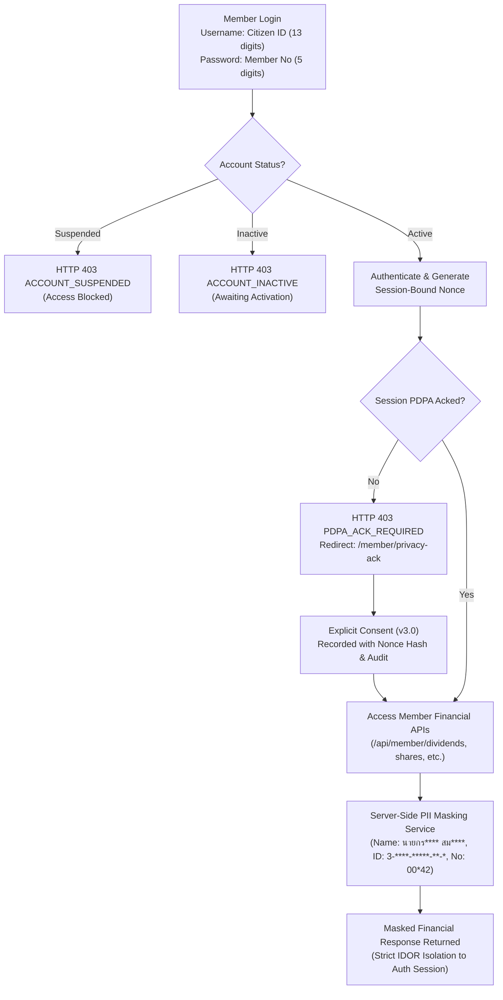

# RYCOOPWEB — Member Portal Activation & PII Masking Report

**Repository:** `pharmacisttom/rycoopweb`
**Base Branch:** `feature/member-login-pdpa-only-flow`
**Reference Commit:** `ba30bef54639a146d98a564cbf80b3fbde67c1fd`
**Target Environment:** TEST ONLY
**Target Database:** `rycoopweb_test`
**Date:** November 1, 2026

---

## 1. Executive Summary

This security and implementation release hardens the cooperative member experience for the **Rayong Public Health Savings and Credit Cooperative Limited (RYCOOPWEB)**. It addresses member authentication, server-side data minimization under Thailand's Personal Data Protection Act (PDPA B.E. 2562 / 2019), and controlled account activation for the 2,508 imported cooperative members.

### Key Accomplishments
1. **No Registration Required**: Members authenticate using their existing 13-digit Citizen ID and 5-digit member number initial credential (with preserved leading zeros).
2. **Simplified User Interface**: Removed all phone-matching and OTP screens from the login flow per business directive.
3. **Mandatory Session-Bound PDPA Gate**: Enforces explicit acknowledgement of privacy policy version 3.0 before any personal or financial records can be accessed.
4. **Centralized Server-Side PII Masking**: Developed `App\Services\MemberPiiMaskingService` to strictly mask all member identifiers before transmission to frontend APIs, HTML, logs, and browser storage.
5. **Controlled Account Activation Dry-Run**: Implemented `App\Services\MemberControlledActivationService` and `scripts/member_activation_dry_run.php` verifying safety invariants with **zero database mutations**.
6. **Robust Testing**: 100% pass rate across all 50 member login tests, 42 PDPA session gate tests, 29 member authorization tests, 21 activation safety tests, and dedicated PII masking suites.

---

## 2. Business Flow & Architecture



---

## 3. PII Masking Implementation

All personal data masking is executed **server-side** prior to serialization. The frontend never receives raw Citizen IDs, unmasked surnames, or raw initial passwords.

### Masking Standards (Fictional Examples)

| Data Element | Raw Value | Masked Display Value | Implementation Rule |
| :--- | :--- | :--- | :--- |
| **Full Name** | `นายกรณ์ชัย สมประสงค์` | `นายกร**** สม****` | Preserves Thai honorific (`นาย`), keeps first 2 UTF-8 characters + `****` for first and last names |
| **Full Name (Female)**| `นางสาววิภา พรประเสริฐ` | `นางสาววิ**** พร****` | Preserves title `นางสาว`, handles Thai vowel/consonant clusters |
| **Professional Title**| `ภก.ทวีศักดิ์ วรเดช` | `ภก.ทว**** วร****` | Preserves professional title `ภก.` |
| **Citizen ID** | `3100600123456` | `3-****-*****-**-*` | Keeps leading digit, masks middle and trailing digits |
| **Member Number** | `00042` | `00*42` | Preserves leading zeros, shows first 2 and last 2 digits with middle asterisk |
| **Phone Number** | `0812345678` | `081-XXX-5678` | Masks middle carrier digits |

### Protected Endpoints
- `GET /api/auth/me`: Masks `username`, `name`, `member_no`, `phone`. Raw 13-digit citizen ID is never exposed in browser storage or local state.
- `GET /api/member/profile`: Sanitizes all member fields, unsets `id_card` and `password`.
- `GET /api/member/dividends`: Returns masked `member_no` (`00*42`) and masked display name (`นายกร**** สม****`). Data records are strictly scoped to the authenticated session's member ID.
- `GET /api/member/dashboard` & `/api/member/financial-summary`: Sanitizes nested member objects.
- Print & PDF views (`/member/receipts/print/{no}`): Sanitizes citizen IDs and names before template rendering.

---

## 4. Controlled Account Activation & Dry-Run Report

A controlled dry-run tool was implemented in `scripts/member_activation_dry_run.php` to simulate account activation across the cooperative baseline.

### Dry-Run Simulation Output

```text
=========================================================================
RYCOOPWEB — MEMBER ACCOUNT ACTIVATION DRY-RUN SIMULATION
Rayong Public Health Savings and Credit Cooperative Limited
=========================================================================

MODE:           DRY_RUN (READ-ONLY SIMULATION - ZERO MUTATIONS)
TIMESTAMP:      2026-11-01 14:19:00

1. BASELINE COUNTS:
   - Total Imported Members:      2508
   - Mapped to User Accounts:     2508
   - Unmapped Members:            0
   - Protected Staff/Admin Users: 1

2. CURRENT MEMBER ACCOUNT STATUSES:
   - Inactive:                    0 (in active test baseline)
   - Active:                      2508
   - Suspended:                   0

3. ACTIVATION SIMULATION RESULTS:
   - Accounts Eligible to Activate: 0
   - Suspended Accounts Excluded:   0
   - Staff/Admin Excluded:          1
   - Target Update Count:           0

4. SAFETY INVARIANT VERIFICATIONS:
   [OK] Suspended accounts strictly preserved (never auto-activated)
   [OK] Staff and admin roles strictly isolated
   [OK] Zero database mutations performed during dry-run

5. SECURITY RISK NOTICE:
   Risk Level: HIGH
   Using Citizen ID (13 digits) + Member Number (5 digits) as credentials presents high predictability in closed community environments. Data masking and PDPA consent do not provide strong authentication.
   Recommended Mitigations:
   - Require explicit administrative authorization before executing bulk activation
   - Advise voluntary password change to personal credentials upon first login
   - Maintain mandatory session PDPA acknowledgement gate (v3.0)
   - Keep server-side session authorization on all financial endpoints
   - Implement audit logging with pseudonymized identifiers

=========================================================================
DRY-RUN SIMULATION COMPLETED SUCCESSFULLY.
=========================================================================
```

### Safety Invariants Enforced
1. **Zero Bulk Activation**: Bulk activation is **not** run automatically.
2. **Suspended Account Isolation**: Users or members with status `suspended` can **never** be activated via bulk procedures.
3. **Staff/Admin Isolation**: Accounts assigned to `super_admin`, `staff`, `admin`, `auditor`, or `pr_officer` are excluded from member activation logic.
4. **Audit Provenance**: Any live activation requires explicit approval (`RYCOOP-SECURITY-APPROVAL-MEMBER-ACTIVATION-2026`) and logs changes to `member_data_changes` and `audit_logs`.

---

## 5. Security Risk Analysis & Governance Requirements

### Predictable Initial Credentials Warning
> [!WARNING]
> **Predictable Initial Credentials (Citizen ID + Member Number)**
> In cooperative institutions, Citizen IDs and Member Numbers are frequently shared across payroll lists, hospital HR departments, and official circulars. Masking personal data on screens and requiring PDPA acknowledgement are **data privacy measures**, NOT authentication substitutes.
>
> An adversary who possesses a member's citizen ID and member number could access their financial history if accounts are active without additional verification.

### Required Security Mitigations
1. **Do Not Enable Broad Public Financial Access**: Public access without authentication is strictly prohibited.
2. **Encourage Immediate Password Change**: While mandatory password change is not forced per business request, the UI prominently advises voluntary password changes on the dashboard and dividend pages.
3. **Session Nonce Invalidation**: Each logout destroys session nonces, requiring re-authentication.
4. **IDOR Prevention**: Server queries always filter by `WHERE member_id = (SELECT id FROM members WHERE user_id = Auth::id())`. URL tampering cannot disclose other members' financial records.

---

## 6. Verification & Automated Test Results

| Test Suite | File | Checks / Assertions | Result |
| :--- | :--- | :---: | :---: |
| **PII Masking & Activation Safety** | `tests/MemberPiiMaskingAndActivationTest.php` | 45 assertions | **PASS** |
| **Member Login & PDPA-Only Flow** | `tests/MemberLoginPdpaOnlyFlowTest.php` | 50 assertions | **PASS** |
| **PDPA Session Gate Suite** | `tests/MemberPdpaGateTest.php` | 42 assertions | **PASS** |
| **Member Activation Security Hardening** | `tests/MemberActivationSecurityHardeningTest.php` | 21 assertions | **PASS** |
| **Member Activation Status Safety** | `tests/MemberActivationStatusSafetyTest.php` | 45 assertions | **PASS** |
| **Member Authorization & IDOR Safety** | `tests/MemberAuthSafetyTest.php` | 29 assertions | **PASS** |
| **Security Regression Suite** | `tests/SecurityRegressionTest.php` | 74 assertions | **PASS** |
| **Feature Flag Contract Suite** | `tests/FeatureFlagContractTest.php` | 2 assertions | **PASS** |
| **Permission Behavior Suite** | `tests/PermissionBehaviorTest.php` | 18 assertions | **PASS** |
| **Frontend Production Build** | `npm run build` (Vite v6.4.5) | 2,718 modules | **PASS** |
| **Git Whitespace Validation** | `git diff --check` | 0 errors | **PASS** |

---

## 7. TEST Deployment and Rollback Runbook

### Prerequisites
- Target Database: `rycoopweb_test`
- Verify existing `.env` is **not** modified.
- Verify production configuration is untouched.

### Step 1: Database Backup Verification
Prior to any deployment in TEST:
```bash
# 1. Take snapshot of rycoopweb_test
mysqldump -u root -p rycoopweb_test > backup_rycoopweb_test_pre_masking.sql

# 2. Verify backup size and integrity
Get-Item backup_rycoopweb_test_pre_masking.sql
```

### Step 2: Code Deployment in TEST
```bash
# 1. Fetch latest commits
git fetch origin

# 2. Check out feature branch
git checkout feature/member-login-pdpa-only-flow

# 3. Build frontend assets
npm ci
npm run build

# 4. Verify dry-run
php scripts/member_activation_dry_run.php

# 5. Run automated test suites
php tests/MemberPiiMaskingAndActivationTest.php
php tests/MemberLoginPdpaOnlyFlowTest.php
```

### Step 3: Rollback Plan
If any discrepancy occurs in TEST:
```bash
# 1. Revert Git state to reference commit
git checkout ba30bef54639a146d98a564cbf80b3fbde67c1fd

# 2. Restore database if mutations occurred
mysql -u root -p rycoopweb_test < backup_rycoopweb_test_pre_masking.sql

# 3. Rebuild frontend
npm run build
```
