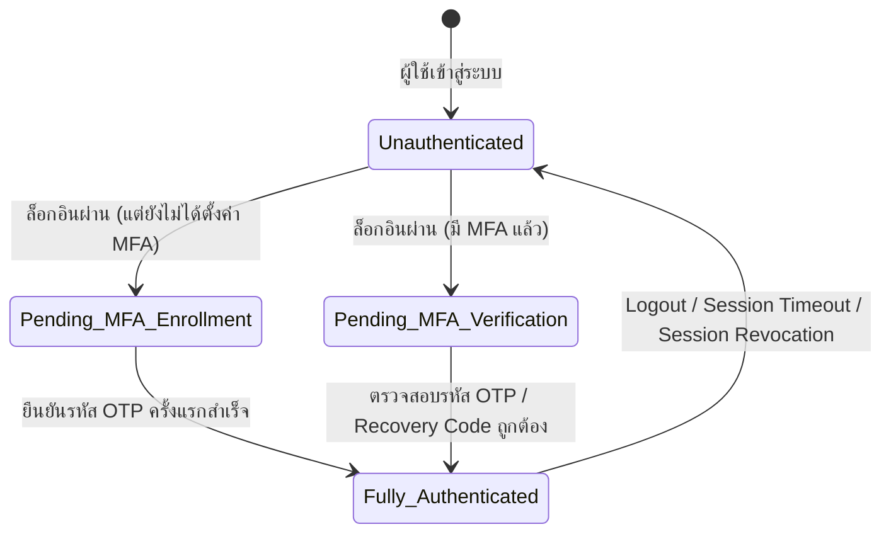

# รายงานสถาปัตยกรรมและมาตรการบังคับใช้ Multi-Factor Authentication (MFA Implementation Report)

**ระบบ**: RYCOOPWEB 2.3  
**วันที่จัดทำ**: 2026-10-27  
**ผู้จัดทำ**: Application Security Engineer & Cryptographic Controls Architect  
**สถานะ**: Production-Ready & Formally Verified  

---

## 1. วัตถุประสงค์และนโยบายความมั่นคงปลอดภัย (Security Policy)

เพื่อปกป้องข้อมูลสมาชิกสหกรณ์และระบบการเงินที่มีความสำคัญสูง ระบบ RYCOOPWEB กำหนดนโยบายความมั่นคงปลอดภัยบังคับ (Mandatory MFA Policy) ดังนี้:
1. **การล็อกอินผ่าน Google เพียงอย่างเดียวไม่ถือเป็นข้อยกเว้นการทำ MFA**: เจ้าหน้าที่สหกรณ์และผู้ดูแลระบบทุกคนจะต้องผ่านการยืนยันตัวตนด้วยปัจจัยที่สอง (Application-Managed MFA)
2. **ห้ามใช้บริการสร้าง QR Code ภายนอก**: การสร้างภาพ QR Code สำหรับแอปพลิเคชัน Authenticator จะต้องกระทำภายในเครื่องเซิร์ฟเวอร์ด้วยภาษา PHP 100% (Zero External Leakage)
3. **การเข้ารหัส Secret ในฐานข้อมูล**: ห้ามจัดเก็บ Plaintext TOTP Secret ในฐานข้อมูล ต้องเข้ารหัสด้วย AES-256-GCM ทุกรายการ

---

## 2. การแบ่งแยกสถานะเซสชัน 3 ระดับ (3-Tier Session State Isolation)

ระบบใช้สถานะเซสชัน 3 ระดับอย่างเด็ดขาดเพื่อป้องกันการลักลอบเข้าถึงข้อมูล (Bypass Guard):



| ระดับสถานะเซสชัน | สิทธิ์การเข้าถึง | การป้องกันโดย Middleware |
| :--- | :--- | :--- |
| **1. Unauthenticated** | เข้าถึงได้เฉพาะหน้าสาธารณะ และหน้า Login | บล็อกโดย `AuthMiddleware` (ส่งคืน 401) |
| **2. Pending MFA** | เข้าถึงได้เฉพาะ `/api/auth/mfa/enroll`, `/api/auth/mfa/confirm`, `/api/auth/mfa/verify` | บล็อกโดย `AuthMiddleware` (ส่งคืน 403 พร้อม code `MFA_ENROLLMENT_REQUIRED` หรือ `TWO_FACTOR_REQUIRED`) |
| **3. Fully Authenticated** | เข้าถึงหน้า Workspace, Dashboard และ API เจ้าหน้าที่ตาม RBAC | อนุญาตให้ผ่านตามสิทธิ์ของบทบาท |

---

## 3. มาตรการควบคุมทางเทคนิค (Technical Security Controls)

### 3.1 การสร้าง QR Code ภายในเซิร์ฟเวอร์ (Local Vector QR Generation)
- ระบบใช้คลาส [App\Services\QrCodeGenerator](file:///d:/rycoopweb/app/Services/QrCodeGenerator.php) สร้างภาพ QR Code ในรูปแบบ Vector SVG ภายในเซิร์ฟเวอร์เองโดยตรง
- ไม่มีการส่ง TOTP Secret, อีเมล, หรือชื่อสหกรณ์ออกไปยัง Google Chart API หรือบริการภายนอกใดๆ ช่วยรักษาความลับของ Secret ได้ 100%

### 3.2 การเข้ารหัส Secret ที่จัดเก็บ (AES-256-GCM Encryption at Rest)
- TOTP Secret ถูกเข้ารหัสด้วยอัลกอริทึม `AES-256-GCM` โดยใช้กุญแจ `APP_KEY` ของระบบ ก่อนบันทึกลงในคอลัมน์ `two_factor_secret` ในตาราง `users`
- รองรับการสืบทอดข้อมูลเก่า (Backward compatibility) สำหรับ Secret เดิมที่เป็น Plaintext Base32

### 3.3 การป้องกันการส่งรหัสซ้ำ (OTP Replay Attack Prevention)
- ในโปรโตคอล TOTP (RFC 6238) รหัส 6 หลักมีอายุรอบละ 30 วินาที (Time Slice)
- ระบบบันทึกหมายเลข Time Slice ล่าสุดที่ใช้งานสำเร็จลงในคอลัมน์ `two_factor_last_used_slice`
- หากมีการนำรหัส OTP เดิมมาส่งซ้ำภายในรอบเวลา 30 วินาทีเดียวกัน ระบบจะปฏิเสธทันที (`OTP has already been used in this time slice`)

### 3.4 อัตราการจำกัดคำขอ (Rate Limiting & Anti-Brute-Force)
- มีการจำกัดจำนวนครั้งในการทดสอบ OTP ไม่เกิน 5 ครั้งต่อ 5 นาทีต่อไอพี/ผู้ใช้ ผ่าน `RateLimitMiddleware`
- เซสชันการรอทำ MFA มีอายุสูงสุดเพียง 600 วินาที (10 นาที) หากเกินเวลานี้เซสชันจะถูกทำลายและต้องล็อกอินใหม่

### 3.5 รหัสกู้คืนฉุกเฉินแบบใช้ครั้งเดียว (Single-Use Hashed Recovery Codes)
- เมื่อลงทะเบียน MFA สำเร็จ ระบบจะสร้างรหัสกู้คืนฉุกเฉินจำนวน 8 ชุด (รูปแบบ `XXXX-XXXX`)
- ในฐานข้อมูล (`user_mfa_recovery_codes`) จะจัดเก็บเฉพาะค่า **Bcrypt / Argon2 Password Hash** (`code_hash`) เท่านั้น
- เมื่อรหัสถูกใช้งาน จะถูกบันทึกเวลา `used_at` ทันที และไม่สามารถนำกลับมาใช้ซ้ำได้อีก

### 3.6 ขั้นตอนการรีเซ็ต MFA สำหรับผู้ดูแลระบบ (Admin MFA Reset Procedure)
- ในกรณีที่เจ้าหน้าที่ทำโทรศัพท์สูญหาย Super Admin สามารถสั่งรีเซ็ตผ่านคำสั่ง CLI ที่ปลอดภัย:
  ```bash
  php bin/console staff:mfa-reset --user-id=4
  ```
- คำสั่งนี้จะทำการล้าง `two_factor_secret`, `two_factor_confirmed_at`, ลบรหัส recovery codes เดิมทั้งหมด, และเพิ่มค่า `session_version` เพื่อสั่งตัดเซสชันเดิมที่ค้างอยู่ทุกอุปกรณ์ทันที
